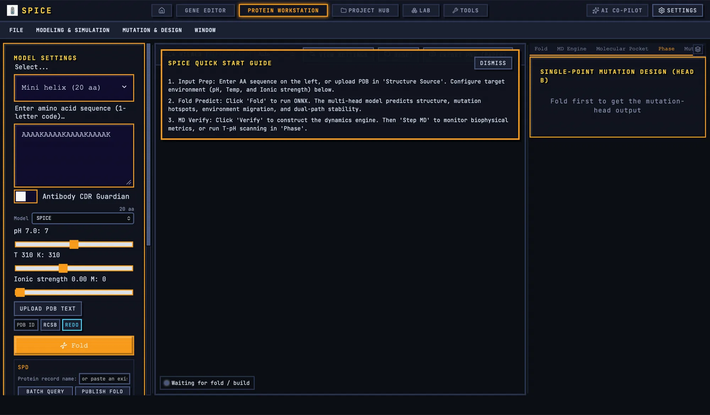

# Mutation Analysis Panel

The Mutation Analysis Panel reads the mutation head of the current fold result, lists the most probable single-residue substitutions at each position, and lets you apply one substitution or a combination to the sequence. It also shows the model's path B confidence, its recommended environmental offset, a mutant Cα trace for comparison, and an export of that trace. All values are model predictions and hypotheses that need experimental validation.

**Menu:** **Window → Mutation Analysis Panel** · **Type:** right-hand work pane (not a floating window)

## What it does

The pane requires a completed fold of the current sequence. Head B of the fold model returns a per-position, 20-value substitution profile. For every position the pane takes the highest-probability residue, discards it when it matches the residue already present, sorts the remaining positions by probability in descending order, and shows the top eight. Positions are displayed 1-based, while the underlying index is zero-based. The probability column is the model output for that substitution, shown as a percentage to one decimal place; it is not a ΔΔG, a stability change, or a measured fitness effect.

The confidence section reports path B from the fold model's path-confidence head as a percentage bar, plus the environmental offset head's recommended ΔpH and ΔT. **Apply** adds that offset to the pH and temperature sliders, clamping pH to 0–14 and temperature to 250–400 K; it does not re-fold. Head B' supplies a second Cα trace for the same sequence. The **View mutant Cα** toggle switches the 3D viewer between that trace and the Head A or latest MD coordinates, and **Export mutant mmCIF** writes the Head B' trace to `spice_mutant_L<length>.cif`.

The mutation cart holds at most one substitution per position. Its epistasis compatibility score pairs cart entries whose predicted Cα atoms lie within 8 Å: an opposite-charge pair (K/R/H against D/E) or two aromatic substitutions (W/Y/F) counts as synergistic at −3.5 kcal/mol each, and two identical aromatic substitutions count as a clash at +5.0 kcal/mol each. Applying the cart sends all selected positions to the mutation engine in one call, writes the new sequence, clears the fold result, and empties the cart. Applying a single row does the same for one position. In both cases the fold output is stale afterwards, so the table disappears and the sequence must be folded again for fresh predictions.

## How to use

1. Load or paste a sequence in **Model Settings** on the left and click **Fold**.
2. Open **Window → Mutation Analysis Panel**.
3. Read the ranked table; each row is the most probable substitution at one position.
4. Click **Apply** in a row to change the sequence immediately, or **Add** to place the substitution in the cart.
5. Repeat step 4 for other positions; use the chips in the cart to remove entries, then check the epistasis score.
6. Click **Apply Combinatorial** to write all cart substitutions in one operation.
7. Fold again before interpreting any further mutation suggestions.
8. Optionally tick **View mutant Cα**, export the mutant mmCIF, or click **Apply** beside the environmental offset.

## Inputs and results

| Field | Meaning |
|---|---|
| Fold result | Required input; all mutation rows and both Head B' actions are unavailable until a fold completes. |
| Path B confidence | Fold model confidence for the alternative path, drawn as a percentage bar. |
| Recommended Environmental Offset | Head C suggestion of ΔpH and ΔT relative to the current sliders. |
| Apply (offset) | Adds ΔpH and ΔT to the sliders with pH clamped to 0–14 and temperature to 250–400 K. |
| View mutant Cα | Swaps the 3D viewer between the Head B' mutant trace and the Head A or latest MD coordinates. |
| Export mutant mmCIF | Saves the Head B' Cα trace as `spice_mutant_L<length>.cif`. |
| # | Rank in the table after sorting by probability. |
| Position | Residue number, 1-based. |
| From | Residue in the current sequence at that position. |
| To | Highest-probability replacement residue. |
| Prob | Model probability of that substitution, as a percentage to one decimal place. |
| Apply | Writes that single substitution to the sequence and clears the fold result. |
| Add | Adds or removes the substitution in the combinatorial cart. |
| Combinatorial Mutation Cart | Holds one substitution per position, shown as chips. |
| Epistasis Compatibility Score | Heuristic interaction total in kcal/mol for cart pairs within 8 Å; negative is favourable, positive is unfavourable. |
| Apply Combinatorial | Writes every cart substitution in one engine call, clears the fold result, and empties the cart. |

## Limits and caveats

The table is a shortlist, not a scan of all possible substitutions. Only one replacement per position is offered, only the eight highest probabilities are shown, and ties are ordered by position because the sort is stable. The probabilities come from a learned head and are hypotheses; they do not account for expression, trafficking, ligand binding, or experimental conditions, and they must be validated experimentally.

The status chip indicates whether Head B was trained in the pretrained checkpoint. When it was not, the head is described as trained only in the later reinforcement-learning stage, and its rankings should be treated as provisional even by the model's own standards. Path B confidence is a sequence-level macro confidence, not a per-mutation probability, and the environmental offset is a suggestion applied to the sliders rather than a proven optimum.

The epistasis score is a fixed pairwise heuristic. It uses only predicted Cα distances, treats every qualifying pair independently, ignores side-chain orientation and the rest of the structure, and applies fixed ±3.5 and +5.0 kcal/mol terms. It is not a free-energy calculation. A single mutation may be applied with **Apply** without entering it in the cart, whereas the cart removes any earlier entry at the same position before adding another.

Applying any mutation replaces the sequence and invalidates the fold, the mutation table, the confidence values, and the mutant structure export until the next fold. The exported mmCIF contains the Head B' mutant trace for the current fold, not a relaxed or experimentally determined structure, and it is written even when the cart is not applied.

## Related

- [Protein Workstation](../../protein-workstation.md)
- [Batch Design Screening Panel](batch.md)
