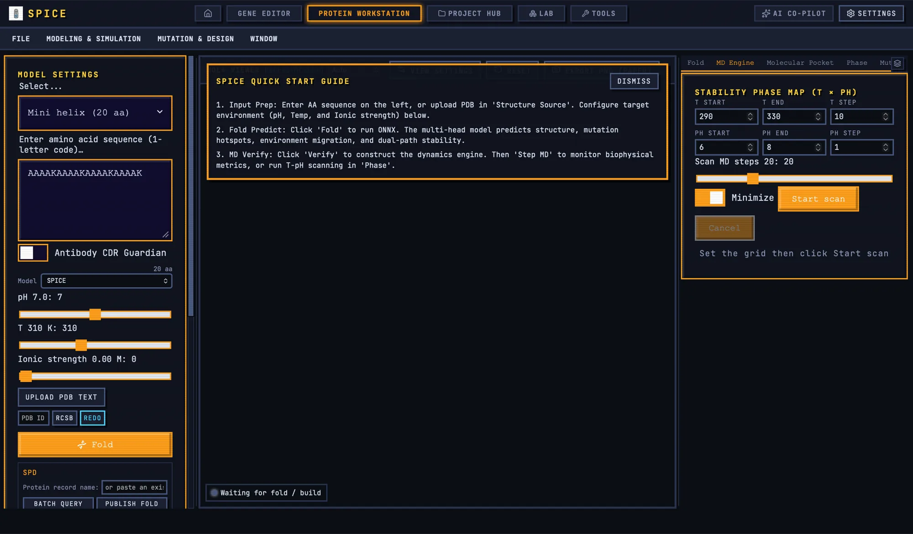

# Environmental Phase Panel

The Environmental Phase Panel scans a grid of temperatures and pH values with the built SPICE engine and colours each point by whether a short dynamics run held together or failed. It also fits a quadratic surface to the grid and reports a suggested folding centre and a phase-boundary limit. The scan is exploratory model output and is not publication-ready.

**Menu:** **Window → Environmental Phase Panel** · **Type:** right-hand work pane (not a floating window)

## What it does

Each grid point is evaluated independently. For every pH in the grid the backend builds a system from the current sequence and Cα structure, then for every temperature it sets the target temperature, runs the requested number of MD steps, and classifies the outcome as stable or crashed. Building at the grid pH means protonation and charge state follow that pH; temperature is applied per point. Pressure and ionic strength come from the environment captured at the last engine build.

The heatmap has one row per pH and one column per temperature. Values are stable, crashed, or not yet computed; the legend also lists a build-failed category. A progress bar and a `done/total` line show the current temperature and pH while the scan runs. **Cancel** stops the scan after the points already returned, and those points remain in the map.

When at least six points exist, the pane fits a least-squares quadratic (Landau-style) surface to the stable and crashed labels and shows a tracker card with the fitted extremum labelled as the metastable folding centre, the boundary point farthest from that centre labelled as the bifurcation limit, whether the fitted surface is a well or a saddle, and the six fitted coefficients. The card is only displayed after a scan of sufficient size.

## How to use

1. Fold a sequence or import a PDB structure and click **Verify**, or click **Build Full-Atom Engine** in the Dynamics Trajectory Panel. The scan needs an existing system; it does not build one itself.
2. Open **Window → Environmental Phase Panel**.
3. Set **T start**, **T end**, and **T step**; the defaults are 290, 330, and 10 K.
4. Set **pH start**, **pH end**, and **pH step**; the defaults are 6.0, 8.0, and 1.0.
5. Choose the **Scan MD steps** slider from 5 to 60 in increments of 5; the default is 20.
6. Leave **Minimize** enabled to relax each grid build with 2000 L-BFGS iterations, or disable it for an unrelaxed build.
7. Click **Start scan** and watch the progress line; click **Cancel** to stop early.
8. Read the heatmap and, when it appears, the bifurcation tracker card.

## Inputs and results

| Field | Meaning |
|---|---|
| T start, T end, T step | Temperature grid in kelvin; the end value is included when the step reaches it. |
| pH start, pH end, pH step | pH grid; the end value is included when the step reaches it. |
| Scan MD steps | Dynamics steps run at each grid point, 5 to 60 in increments of 5. |
| Minimize | Runs L-BFGS relaxation on each grid build when enabled. |
| Start scan | Clears the previous map and evaluates the grid in pH-major order. |
| Cancel | Sets the backend cancel flag; completed points stay in the map. |
| Progress | Completed points out of the total, with the current temperature and pH. |
| Stability heatmap | Rows are pH, columns are temperature; colours mark stable, crashed, or build-failed points. |
| Legend | Stable, Crashed, and Build failed categories. |
| Metastable folding centre | Extremum of the fitted quadratic surface, given as a temperature and pH. |
| Critical bifurcation limit | Boundary point farthest from the centre, weighted towards pH distance. |
| Surface type | Reports a stable well or an unstable saddle from the fitted quadratic terms. |
| Fitted formula | The six coefficients of the quadratic fit in temperature and pH. |
| Demo phase map | Marks a synthetic scan produced without the native backend. |

## Limits and caveats

The SPICE model is under development and the scan inherits that status. The stable and crashed labels come from fixed internal thresholds applied after a short run, so they are coarse, unvalidated classifications rather than measured melting temperatures, free energies, or phase boundaries. There are no error bars, repeats, or statistical tests, and the grid resolution is whatever the step fields produce.

The scan needs a system from an earlier build; without one it stops with a message telling you to run Build first. The sequence and Cα coordinates are those of the last build, and pressure and ionic strength are fixed from that build environment, so changing the sliders afterwards does not alter them. Changing the sequence or structure requires a new build before scanning.

The grid fields are plain number inputs with no validation. A zero step does not advance the grid and a negative step yields no points, so use positive steps and sensible ranges. A large grid multiplies the requested steps by every pH and temperature pair and can take a long time. The build-failed state exists in the scan data, but the progress path used by this panel records a failed grid build as a non-stable point, so it appears in the crashed colouring rather than as a separate build failure.

The bifurcation card is a qualitative fit to ternary labels: stable contributes a fixed negative value, crashed or failed a fixed positive value, and the least-squares quadratic is solved in normalised temperature and pH. The reported centre is the extremum of that fit and the limit is the farthest fitted boundary point, not a thermodynamic bifurcation or a measured cooperative transition. The six coefficients are not a free-energy surface, and with only six points the fit is barely constrained.

Each **Start scan** replaces the previous map, and the results are not saved automatically. The active tab is remembered in local storage, but the scan, the tracker, and its coefficients are discarded when you leave the route. The `.spicep` export and the protein project document do not include the phase scan, and the pane has no export control of its own. A browser or fallback scan is synthetic and is flagged as a demo phase map.

## Related

- [Protein Workstation](../../protein-workstation.md)
- [Dynamics Trajectory Panel](md.md)
- [Structure Folding Panel](folding.md)
