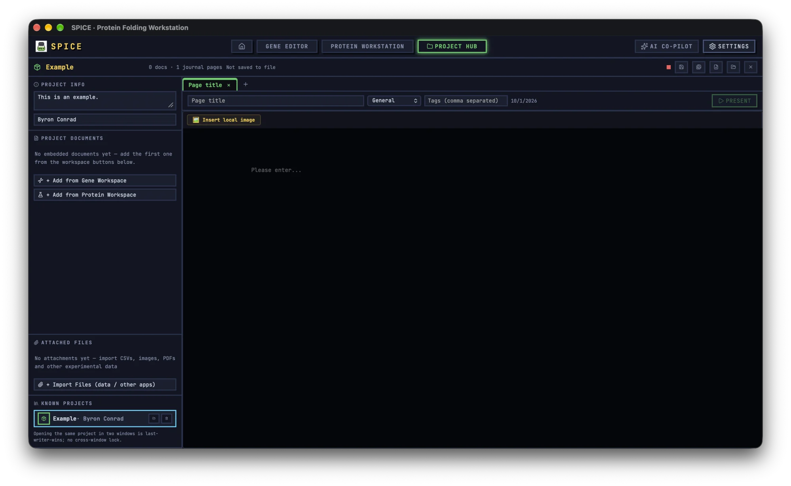

# Project Hub

The Project Hub is the archive and notebook for a study. A single `.spiceproj` file contains project metadata, embedded gene/protein/tool documents, journal pages, and attached files.

## 1. What the hub is for

Use the hub when a result needs to survive beyond one tool session. A standalone gel project or qPCR CSV is fine for a quick check. A project is the right container when you need to connect the construct, the raw images, the analysis, the notebook page, and the final figure in one file that can be copied to lab storage.

A project can contain:

- **Gene documents** captured from the Gene Editor.
- **Protein documents** captured from the Protein Workstation.
- **Tool documents** for gel, western blot, qPCR, plate, colony, annotator, tree, and Figure Studio.
- **Journal pages** written in Markdown, with categories and tags.
- **Attachments** such as CSV exports, images, PDFs, and instrument files.
- **Presenter slides** generated from a journal page.

## 2. Create a project

1. Open **Project Hub** from the top navigation.
2. Click **New Project**.
3. Enter a **Project name**. Use a name another lab member can recognise, such as `2026-11_AKT1_WB`.
4. Optionally enter the **Principal Investigator**. If a verified ORCID profile is loaded, this field is prefilled from the ORCID display name.
5. Add a short **Project description**.
6. Click **New Project**. The project opens with one empty journal page.

The project is held in memory and snapshotted locally, but it is not written to disk until you click **Save**. Save it to a lab-managed location immediately.

## 3. Open, save, and close

### 3.1 Save

Click **Save** in the title bar. If the project already has a file path, SPICE GUI overwrites that file. If it has no path, a native save dialog opens. The default name is `<project name>.spiceproj`.

Use **Save As** when you want a second copy or a versioned archive. The file is written as the private SPJB container; it stores the project JSON plus binary chunks for coordinates, images, and attachments.

### 3.2 Open

Click **Open Project** and select a `.spiceproj` file. The hub accepts the current SPJB format and the older gzip-JSON and plain-JSON generations. On success the toast says **Project imported**. If parsing fails, the toast says **Project file could not be parsed** and includes technical detail.

Opening a project from an external file clears the stored file path, so the first **Save** asks where to write it. This is intentional: the hub does not assume that the imported location is writable or that it should overwrite the source.

### 3.3 Resume and snapshots

The hub keeps a local snapshot so that a crash or an accidental reload does not lose the current session. When no project is open and a snapshot exists, **Resume Last Session** appears. The hub also auto-restores the current session on mount if no project is open.

**Known Projects** is a registry of payload-free summaries. Each row can be reopened from its local snapshot. This is not a disk index: it does not scan your folders, and the snapshot may be older than the `.spiceproj` file. Use **Open Project** for the authoritative file.

### 3.4 Close

**Close Project** clears the in-memory project and the current-session snapshot. If the project is dirty, a confirmation appears. Read the buttons carefully: **Save** starts a save and then closes without waiting for the file write to finish. For important work, click **Save** in the title bar, confirm the file exists, then close.

## 4. Project documents

### 4.1 Capture from a workspace

The hub can take a snapshot of the current state of a workspace or tool.

**Gene and protein:**

1. Open the project in the hub.
2. Click **+ Add from Gene Workspace** or **+ Add from Protein Workspace**.
3. The app navigates to that workspace with a capture handoff.
4. The live state is serialised, added as an embedded document, and the app returns to the hub.
5. The toast **Document added to project** confirms the capture.

**Bench tools:**

1. Choose a tool from the **Tool** selector and click **Capture from tool**.
2. The tool opens. Some tools refuse capture when there is nothing to capture; for example, the gel editor needs a loaded image.
3. After the capture, save the project.

Alternatively, open a tool while a project is active and use **Save to Project (Ctrl+S)** in the tool's project strip. If no document is active, this button creates a new document from the current tool state.

### 4.2 Open an embedded document

Click **Open** on a document row. The workspace or tool opens with the embedded payload restored, and a banner shows `{project} › {document}`. Edits write back into the in-memory project. The `.spiceproj` file itself is written only when you save.

### 4.3 Rename, export, and remove

- **Rename** is available from the row menu or by double-clicking the name.
- **Export Standalone** writes `.spiceg` for a gene, `.spicep` for a protein, or `<kind>.json` for a tool document.
- **Remove** removes the document from the project. The confirmation notes that standalone files are unaffected.

### 4.4 Insert into a journal page

If a tool document has a preview image, the row offers **Insert into journal**. It inserts a Markdown image and an italic summary into the active journal page, or into a new page if none is active. Gene and protein captures currently do not carry previews, so this action is effectively a tool-document feature.

## 5. Journal pages

### 5.1 Create and edit a page

- Click **+ New Page** to add a page.
- Click a page tab to switch to it. The last active page per project is remembered.
- The meta bar contains **Page title**, **Category**, **Tags (comma separated)**, and the creation date.
- Categories are **General**, **Experiment**, **Meeting**, and **Protocol**.
- Tags are trimmed, de-duplicated by normalisation, and stored comma-separated.

The Markdown editor supports headings, lists, tables, code blocks, links, images, and inline formatting. Use **Insert local image** to embed an image as a base64 data URI; the journal remains self-contained and offline.

Deleting a page is immediate and has no confirmation. Be careful with the page close button.

### 5.2 What to write

A useful experiment page has four parts:

1. **Purpose** — the question and the construct or sample.
2. **Conditions** — instrument settings, antibodies, dilutions, and controls.
3. **Results** — a short summary and a link to the embedded document or attachment.
4. **Interpretation** — what you concluded, what failed, and the next step.

The journal is a Markdown document, not a spreadsheet. Keep raw numbers in the attached CSV or tool document, and use the page to explain what they mean.

## 6. Attachments

Click **+ Import Files (data / other apps)** and select one or more files. Each file is limited to **20 MiB**. Larger files should stay standalone and be referenced in the journal.

Attachment rows offer **Preview**, **Rename**, **Save As**, and **Remove**:

- Images render inline.
- PDFs render in an iframe.
- Text-like files show the first 200,000 bytes.
- Other types show **This file type cannot be previewed — save it and open with an external app**.

Removing an attachment from the project does not delete the original file on disk.

Attachments increase the `.spiceproj` size because they are embedded. For large imaging datasets, store the raw files in the lab archive and attach only the analysed export or a representative image.

## 7. Presenter mode

The journal can drive a lab-meeting presentation without a separate slide deck.

1. Open a journal page.
2. Click **Present**. The button is disabled when the page has no slide title or body.
3. The presenter parses the Markdown into slides.

### 7.1 Slide grammar

- `---` starts a new slide.
- An H1 or H2 heading starts a new slide.
- Paragraphs, lists, task lists, tables, fenced code, and images appear on the slide.
- Blockquotes (`>`) become speaker notes and are visible only in presenter view.
- Lines beginning with `//` are presenter-only comments and are never rendered.
- Footnotes, superscript, subscript, highlight, strikethrough, and reference links are supported.

A practical page starts with a title slide, one slide per result, and blockquotes for the points you want to say aloud.

### 7.2 Presenter controls

| Key | Action |
|---|---|
| `→`, `↓`, `Page Down`, `Space` | Next slide |
| `←`, `↑`, `Page Up` | Previous slide |
| `Home` / `End` | First / last slide |
| `P` | Toggle presenter view |
| `F` | Fullscreen |
| `Esc` | Leave fullscreen first, then close Presenter |

Clicking the empty overlay advances one slide. The audience view shows the slide and a progress bar. The presenter view adds the elapsed timer, slide counter, **Next Slide** preview, and **Speaker Notes**.

## 8. Unsaved state and Ctrl+S

The title bar shows a dirty LED with the tooltip **Unsaved** or **In sync**. The hub registers `Ctrl`/`Cmd`+`S` at window level, but it intentionally ignores the shortcut while focus is inside an input, textarea, select, or contenteditable element. When you are editing the journal body, use the title-bar **Save** button instead.

In the Gene Editor, `Mod+S` is part of the keymap and saves the active embedded document. The Protein Workstation banner registers its own `Ctrl`/`Cmd`+`S` only while a protein document is active. Bench tools expose **Save to Project (Ctrl+S)** as a button but do not register a global shortcut.

## 9. Known Projects and local storage

The **Known Projects** registry is stored in the WebView's local storage, not in the `.spiceproj` file. It contains summaries only: name, PI, update time, file count, and path. The per-project snapshots are also local.

This has three consequences:

- The registry does not travel when you copy the `.spiceproj` to another computer.
- Removing a registry record does not delete the file on disk; it only removes the local summary and snapshot.
- Opening the same project in two windows is last-writer-wins. There is no cross-window lock.

## 10. ELN signing

The Gene Editor's **Notes** tab contains the ELN. It can sign a page with a verified ORCID identity, lock the page, and generate a Markdown report with an audit trail and a SHA-256 digest.

The signature is an unkeyed digest of canonical page metadata, not a private-key cryptographic signature. It is tamper-evident only if you retain the digest independently, for example in the downloaded report. The UI is styled after 21 CFR Part 11 expectations, but it is not a certification of your institution's compliance program. Follow your local SOP for records, signatures, and retention.

See [Gene Editor](gene-editor.md) for the signing workflow.

## 11. Backup checklist

1. Save the `.spiceproj` file to lab-managed storage.
2. Keep the original raw images and instrument exports outside the project.
3. Export a reproducibility bundle for each analysis you may need to defend.
4. Copy model files separately if you move to another computer.
5. Export signed ELN Markdown reports and retain them with the records.
6. Remember that snapshots and the Known Projects registry are local-only.
7. Do not rely on autosave as a backup. The file is authoritative.
