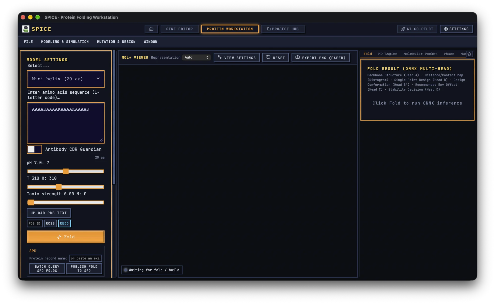

# Protein Workstation

The Protein Workstation is the structural-biology side of SPICE GUI. It combines sequence input, multi-head fold inference, experimental structure import, short all-atom MD verification, stability scans, mutation design, and a Mol* viewer.

> **Model status: exploratory, not publication-ready.** The shipped SPICE checkpoint is a pretraining checkpoint. Head A (backbone) and the distogram are trained; the mutation, design-conformation, environment-offset, and stability-confidence heads are RL-stage heads and are randomly initialised in this checkpoint. Treat their outputs as placeholders for method development, not as validated predictions. The app surfaces the relevant warnings, but the responsibility for interpretation remains with you.

## 1. Interface tour

The page has three resizable columns and a top menu bar.

**Left column** contains the inputs and the activity log:

- **Model settings** — example selector, sequence box, residue count, pH/temperature/ionic-strength sliders, structure import, **Fold**, and the optional SPD panel.
- **SPICE Engine settings** — **Verify**, **Steps**, **Bias force**, **Equilibrate**, **ΔT**, **ΔpH**, and **Step MD**.
- **Activity log** — a timestamped record of imports, builds, steps, scans, exports, and errors. The log is not saved across restarts.

**Centre column** is the Mol* viewer. A **SPICE Quick Start Guide** overlay appears on first load; dismiss it when you no longer need it. The status line at the bottom-left reports what is displayed, for example `Showing: Cα trace (129 aa)` or `Waiting for fold / build`.

**Right column** has six tabs: **Fold**, **MD Engine**, **Molecular Pocket**, **Phase**, **Mutation**, and **HT Screening**. The tab selection is remembered. The pin button on the tab strip opens the **BIOPHYSICS MONITOR (PINNED)** HUD over the bottom of the workspace.

The top menus are **FILE**, **MODELING & SIMULATION**, **MUTATION & DESIGN**, and **WINDOW**. The same actions are available from the left panel and the tabs, so use whichever is more convenient.

## 2. Fold a sequence

### 2.1 Enter the sequence

1. Choose one of the examples from the unlabelled selector, or paste a one-letter amino-acid sequence into **Enter amino acid sequence (1-letter code)…**.
2. Check the residue count shown below the box. The input is limited to 1024 residues and accepts the standard 20 amino acids plus `U`.
3. Set **pH 7.0**, **T 310 K**, and **Ionic strength 0.00 M** to match the condition you want to model. Pressure is fixed at 1 bar in the current build.
4. Click **Fold**. The button changes to **Folding…** while inference runs.

> Paste only the sequence. The parser strips non-letter characters, but a pasted FASTA header can still contribute letters to the sequence. Remove headers and annotation lines first.

### 2.2 Read the fold result

The **Fold** tab reports **Length**, **Model**, and **Latency**, followed by the multi-head legend:

`Backbone Structure (Head A) · Distance/Contact Map (Distogram) · Single-Point Design (Head B) · Design Conformation (Head B') · Recommended Env Offset (Head C) · Stability Decision (Head D)`

The main outputs are:

| Output | Where to look | How to read it |
|---|---|---|
| **Head A reference structure** | Mol* viewer; status line `Showing: Cα trace` | Rainbow Cα trace of the predicted backbone. |
| **Distogram** | **Expected distance matrix (Å)** | Blue-to-red heatmap of expected Cα–Cα distances from 3 to 48 Å. Hover a cell to read the pair and value. |
| **Contact map** | **Contact map (Cα < 8Å)** | Green cells mark contacts above 0.5; dark cells are below threshold. |
| **Head B mutation probabilities** | **Mutation** tab | Top eight substitutions per position with probabilities. |
| **Head B′ design coordinates** | **Mutation** tab, toggle **View mutant Cα** | Replaces the displayed backbone with the design conformation. |
| **Head C environment offset** | **Mutation** tab | Suggested **ΔpH** and **ΔT**; **Apply env offset (Head C)** writes them to the sliders. |
| **Head D stability confidence** | **Mutation** tab | Two progress bars for **Path A (no mutation)** and **Path B (mutated)**. |

The viewer receives Cα coordinates only. The **Cartoon**, **Ball & stick**, and **Spacefill** options are available, but they are rendered from the Cα trace rather than a full all-atom structure.

> Heads B, B′, C, and D are random in the pretraining checkpoint. Do not present the mutation probabilities, the design conformation, the recommended environment offset, or the confidence bars as trained predictions. Head A and the distogram are the outputs to inspect in this build.

### 2.3 Model missing

If the ONNX checkpoint is not configured, the Fold tab shows an **ONNX** alert with the backend error instead of a result. Open **Settings → General Settings → ONNX NEURAL NETWORK MODEL**, point the app at a local checkpoint, or use the cloud download when it is available. The app does not fabricate a successful result in the desktop build; in browser demo mode a `Demo data` chip marks synthetic output.

## 3. Import an experimental structure

### 3.1 Upload a PDB or mmCIF file

Use **Upload PDB text** in the left panel. It accepts `.pdb`, `.ent`, `.cif`, and plain text. The **FILE → Open Sequence/Structure File...** menu accepts `.pdb`, `.ent`, and `.spicep`; use the left-panel picker for mmCIF.

When a structure loads, the app extracts a best-effort sequence, clears any previous fold or engine build, and logs the loaded file. For mmCIF it reads chain A, Cα atoms, and the first alternate location.

### 3.2 Fetch from RCSB PDB

1. Type a four-character PDB ID in the **PDB ID** field.
2. Click **RCSB**. The app downloads the legacy PDB file.
3. On success the sequence is loaded and a ligand-site query runs automatically.
4. On failure, read the activity log or the toast for the HTTP or validation error.

The **MODELING & SIMULATION → Pull Structure from RCSB PDB...** command is a shortcut to the Fold tab, not a separate fetch dialog; use the PDB ID field for the actual retrieval.

### 3.3 Fetch a PDB-REDO re-refinement

1. Enter the PDB ID.
2. Click **REDO**.
3. The app checks PDB-REDO, downloads the `_final.pdb` file when available, and reports the R-free/Ramachandran quality change and clash reduction in the activity log and toast.

PDB-REDO is useful when the original deposition has poor geometry. Keep the original PDB ID and the re-refined file together in your project notes.

### 3.4 What the viewer shows after import

The current viewer displays the engine’s Cα trace, not the original all-atom PDB/mmCIF. This is a deliberate limitation of the current build: imported side chains, ligands, waters, and B-factors are not rendered. Use an external viewer such as Mol* or PyMOL when you need the deposited all-atom coordinates. The imported coordinates are still used by the engine for building and verification.

### 3.5 Ligand-site annotation

When a PDB ID is known, the Molecular Pocket tab can show **BioLiP Biological Ligand Sites** with ligand IDs, names, binding residues, and a catalytic-site overlap flag. The current implementation queries the RCSB entry API and filters common crystallisation additives such as glycerol, PEG, sulfate, and common ions. Treat the overlap flag as a hint, not a validated active-site assignment.

## 4. MD verification with the SPICE Engine

### 4.1 Build the engine

There are two routes:

- Click **Verify** in the left panel. This builds the engine if needed and immediately runs one MD batch.
- Open the **MD Engine** tab and click **Build Full-Atom Engine**. This only builds the system.

A fold or imported PDB/mmCIF is required. The build uses the imported structure when present, otherwise the folded Cα coordinates. L-BFGS relaxation is applied during the build. The **Equilibrate** toggle adds an optional NVT equilibration.

Build progress and errors appear in the activity log. If the build fails, the message is logged as `[FAIL] Build Exception: …` but is not repeated in a page-level error panel, so keep the activity log visible.

### 4.2 Run MD steps

1. Set **Steps** between 1 and 100. The default is 20.
2. Optionally enable **Bias force** and set **Force amplitude**. This injects a random 16-dimensional action to push the system out of a local minimum.
3. Optionally enable **Equilibrate**.
4. Set **ΔT** and **ΔpH** if you want to change the environment before the batch.
5. Click **Step MD**. Repeat for more batches.

The app accumulates the step count, time, kinetic temperature, and milliseconds per step. A red **clamp** count means the engine had to constrain coordinates; investigate before interpreting the run as stable.

### 4.3 Read the MD result

| Panel | Meaning |
|---|---|
| **Potential trajectory U (kcal/mol)** | Energy trace for the most recent batch. It resets each time you click **Step MD**; it is not the full history. |
| **Physical metrics M (stability)** | m1 potential fluctuation, m2 radius-of-gyration drift, m3 secondary-structure loss, m4 clash fraction, and m5 surface-charge mismatch. The bar turns red above its threshold. |
| **2D Conformation Landscape (Rg vs. RMSD)** | Trajectory in RMSD × Rg space, accumulated across batches. The background labels distinguish the stable basin from the unstable cliff. |
| **BIOPHYSICS MONITOR (PINNED)** | Compact HUD with step, temperature, last energy, metrics, and a crash banner. |

A short MD run is a sanity check, not a free-energy calculation. Use it to catch gross clashes, collapse, or a bad build, not to rank close mutants.

If a step crashes, the metric bars can show zero because the metrics object is absent. The separate red crash alert is the authoritative signal; do not read the zero bars as “all metrics are fine”.

### 4.4 A practical MD check

1. Fold or import the structure.
2. Set **Steps** to 20 and leave **Bias force** off.
3. Click **Verify**.
4. Check **m4 clash fraction** first. A high clash fraction means the build or fold needs minimisation.
5. Check **m2 Rg drift** and **m3 secondary-structure loss** for collapse.
6. Check the energy trace for a flat or steadily falling line rather than a spike.
7. Only then increase the batch size or run a temperature/pH scan.

## 5. Molecular Pocket

The **Molecular Pocket** tab reports cavities computed from the physical engine.

1. Build the engine first.
2. Open **Molecular Pocket** and enable **Enable 3D Pocket Detection**.
3. Run at least one **Step MD**; pocket data comes from the step metrics.
4. Select a pocket from **Select pocket:**, for example `PK-1 (volume ų)`.
5. Read **Volume**, **Druggability**, **Net Charge (pH …)**, **Hydrophobic ratio**, **Pharmacophores** (`HYD`, `ACC`, `DON`), and **Lining residues**.

In the current build, pocket information is textual. The viewer does not draw a 3D cavity or ligand overlay. Use the residue list and volume/druggability values to decide whether a pocket is worth following up in a dedicated structural tool.

If the engine is built but no pocket is computed, a fallback panel shows **Pocket Retention Q_pocket** and a hard-coded active-site residue range. Treat that fallback as a sequence heuristic, not a physical pocket calculation.

## 6. Stability phase scan

The **Phase** tab maps stability over a temperature × pH grid.

1. Build the engine.
2. Set **T start**, **T end**, **T step**, **pH start**, **pH end**, and **pH step**.
3. Set **Scan MD steps** between 5 and 60. The default is 20.
4. Leave **Minimize** on unless you have a reason to skip relaxation.
5. Click **Start scan**. Watch the progress line `{done}/{total} · T=…K pH=…`.
6. Use **Cancel** to stop; completed points remain in the heatmap.

The **Stability phase map (T × pH)** uses green for stable, red for crash, purple for build failure, and dark for pending. Hover or tap a cell to read `pH x × T → Stable/Crash/Build failed`.

When at least six points exist, the app fits a **Thermodynamic cooperative-collapse bifurcation tracker** and reports:

- **Metastable folding center (optimal)** — the temperature and pH of the best point.
- **Critical cooperative-inactivation bifurcation limit** — the estimated boundary.
- **Phase surface type (Landau surface)** — stable well or unstable saddle.
- **Fitted formula (Landau expansion)** — the quadratic form used for the fit.

The fit is a quadratic classification of the discrete stable/crash labels, not a measured free-energy surface. Use it to choose follow-up conditions, and report the raw grid alongside the fit.

## 7. Mutation design

Open **Mutation** after a fold. The tab contains four related tools.

### 7.1 Head B substitutions

**Single-Point Mutation Scanning (Head B)** lists the top eight substitutions with columns **#**, **Pos**, **From**, **To**, and **Prob**.

- **Apply** writes the substitution into the sequence and clears the fold result. It does not rebuild or refold automatically.
- **Add** places the substitution in the combinatorial cart.

Remember that Head B is untrained in this checkpoint. The ranking is a demonstration of the workflow, not a recommendation for wet-lab mutagenesis.

### 7.2 Combinatorial cart and epistasis

The **Combinatorial Mutation Cart** collects multiple substitutions. With two or more entries, **Epistasis Compatibility Score** estimates whether the changes are likely to be compatible, using predicted Cα distance, charge complementarity, and aromatic pairs. The score is a heuristic, not a ΔΔG calculation.

Click **Apply Combinatorial** to write all cart mutations into the sequence. As with a single mutation, this edits the sequence only; it does not produce a full mutant model.

### 7.3 Head C environment offset

The **Recommended Environmental Offset (Head C)** row shows a suggested **ΔpH** and **ΔT**. **Apply env offset (Head C)** clamps and writes those values to the sliders. It does not refold or rebuild, so run **Fold** or **Build** again if you want to evaluate the new environment.

### 7.4 Head B′ design conformation

Toggle **View mutant Cα** to replace the viewer structure with the Head B′ design coordinates. The current implementation is a toggle, not a superimposed reference/mutant overlay. The panel itself notes that B′ uses random pretraining weights.

### 7.5 Export mutant coordinates

**Export mutant mmCIF** writes a Cα-only mmCIF with the mutant coordinates and the same `_spice` metadata block as the reference fold. It is suitable for visualization and method development, not for all-atom modelling.

## 8. High-throughput screening

The **HT Screening** tab evaluates a CSV library with local biophysical descriptors.

1. Keep the wild-type sequence in the main sequence box.
2. Paste a CSV into **Input Mutant Library CSV (ID, Mutations):**. The expected header is `ID,Mutations`.
3. Use mutation tokens such as `V15A` or `V15A + I32L`.
4. Click **Run Rayon-Tokio Physical Parallel Screening**.
5. Read the table.

Columns are **ID**, **Mutations**, **Stability Score**, **Net Charge (pH7)**, **GRAVY Hydrophobicity**, **Helix %**, **Disorder**, and **Status**.

The score combines net charge, GRAVY, Chou–Fasman helix propensity, disorder fraction, and a temperature penalty. **Status** is `Pass` when the score is at least 50 and `Failed` otherwise. The label “Rayon-Tokio” describes the intended backend; in the current build the scoring runs locally in the frontend. Treat the result as a triage heuristic, not an engine validation.

Invalid mutation tokens and wild-type mismatches are ignored. If nothing parses, the app reports `No valid variant rows were parsed. Please check the CSV format`.

## 9. Viewer and export

### 9.1 Viewer controls

The Mol* toolbar offers **Representation** (`Auto`, **Cα trace**, **Spacefill**, **Cartoon**, **Ball & stick**), **View settings**, **Reset**, and **Export PNG (paper)**.

**View settings** controls:

- **Background**: Dark, White, Transparent.
- **Camera**: Perspective, Orthographic.
- **Axes**: Off, On.
- **Exposure**, **Light**, and **Size factor**.
- **Outline**, **Shadow**, **Bloom**, and **AO** toggles.
- **Keep SPICE Watermark**, **Transparent Background**, and **Export Resolution** (1×, 2×, 4× supersampling).

The PNG is written as `spice_fold.png` and can include the `Folded by SPICE` watermark. Because the viewer is Cα-only, the PNG is a backbone illustration, not an all-atom figure.

### 9.2 mmCIF

Use **Export mmCIF** for the reference fold or **Export mutant mmCIF** for the mutant. Files are named `spice_fold_L{length}.cif` and `spice_mutant_L{length}.cif`.

The mmCIF contains a `data_SPICE` block with method, environment, length, and confidence fields, followed by a standard `data_structure` block with entity and atom_site records. Only Cα atoms are written; there are no side chains, hydrogens, ligands, waters, or meaningful B-factors.

### 9.3 `.spicep` package

Use **FILE → Export SPICE Status (.spicep)**, or the Fold-card export button (currently labelled `Export complete`), to write a `.spicep` package. The package stores sequence, environment, reference and current coordinates, step count, time, energy history, landscape points, and metrics.

Open a `.spicep` with **FILE → Open Sequence/Structure File...**. The app restores the sequence, environment, coordinates, last MD state, metrics, and landscape, but not the distogram, contact map, mutation probabilities, or Head C offset. If a project document is active, loading a standalone `.spicep` detaches it; the toast warns that further edits will not be written back.

## 10. Project and SPD integration

When the page is opened from a project document, a banner shows `{project} › {document}` with **Save to Project (Ctrl+S)** and **Back to Project Hub**. While the document is active, edits to sequence, environment, fold, build, MD, and landscape write back to the in-memory project. The `.spiceproj` file itself is only written by Save or Save As in the Project Hub.

The left-panel **SPD** section can batch-query existing folds and publish a fold summary. Publishing requires a fold result, a desktop build, and a token configured in **Settings → Public Integrations**. Only summary records, environment, model identity, and derived metrics are uploaded; coordinates and matrices stay local. See the [Project Hub guide](project-hub.md) and [Settings guide](settings.md) for the shared workflow.

## 11. Worked example: lysozyme sanity check

1. Select **Lysozyme 2LYZ (129 aa)** or fetch `2LYZ` with **RCSB**.
2. Leave pH at 7.0, temperature at 310 K, and ionic strength at 0.
3. Click **Fold** and inspect the Cα trace and distogram. Remember that only Head A and the distogram are trained.
4. Click **Verify** with **Steps** set to 20.
5. In **MD Engine**, check **m4 clash fraction** and **m2 Rg drift**. If m4 is high, rebuild with **Minimize** enabled and repeat.
6. Open **Phase**, scan 290–330 K in 10 K steps and pH 6–8 in 1 pH steps with 20 MD steps.
7. Read the heatmap and the Landau fit, but keep the raw grid as the primary record.
8. Open **Mutation**, add one substitution to the cart, apply it, and re-fold if you want to see the effect.
9. Export a `.spicep` package and, if the figure is for a presentation, **Export PNG (paper)**.
10. Capture the protein document into a project and write the interpretation in the journal page.

## 12. Current limitations

These limitations are visible in the current build and should be recorded alongside any result:

- Only Cα coordinates are visualized; imported all-atom structures are not displayed.
- Heads B, B′, C, and D are random in the pretraining checkpoint.
- Pocket and ligand information are textual; there is no 3D cavity overlay.
- Mutation application edits the sequence only; it does not rebuild or refold.
- The MD energy trace shows the latest batch, not the full trajectory.
- The phase Landau fit is a quadratic classifier fit over stable/crash labels.
- The HT screening score is a frontend heuristic.
- `.spicep` does not restore every fold output, and mmCIF export is Cα-only.
- Fold, build, and scan errors are reported mainly in the activity log.
- Sequence/environment/tab state autosaves locally, but fold and simulation results do not. Export a `.spicep` or capture a project document for anything you need to keep.

For the surrounding project workflow, see the [Project Hub guide](project-hub.md). For the shared model configuration, see the [Settings guide](settings.md).
