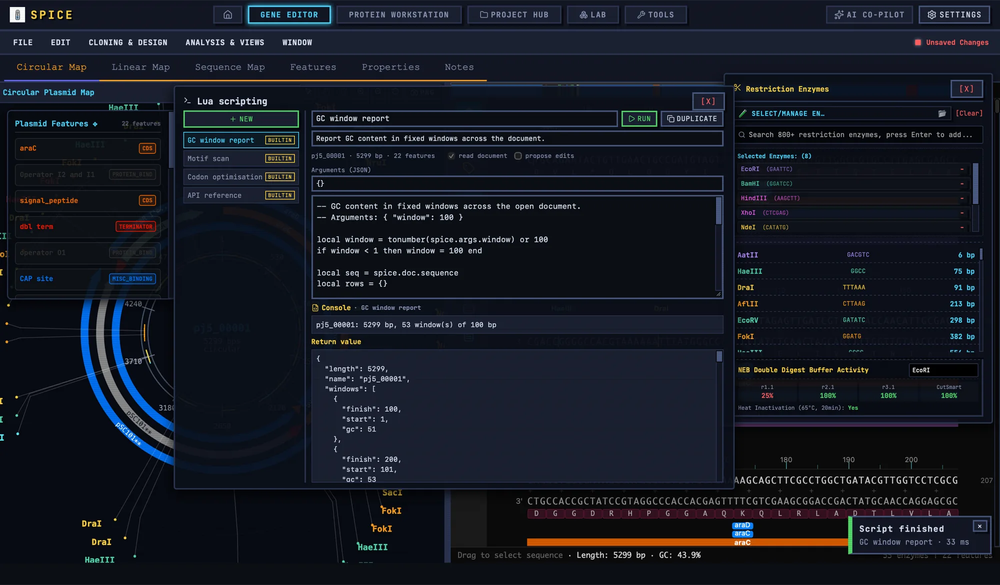
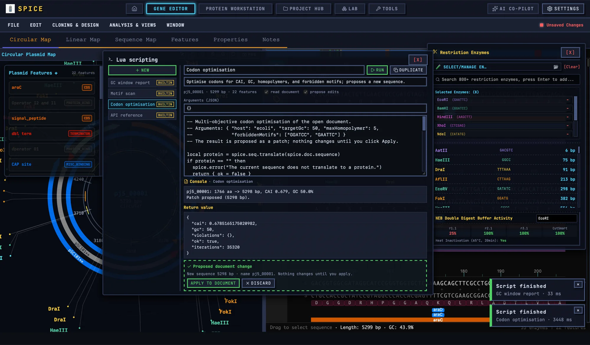

# Lua Scripting

**Applies to:** SPICE GUI v0.5.0

The Gene Editor embeds a Lua 5.4 interpreter so repetitive analysis can be scripted without leaving the app. Scripts run locally in a Web Worker, read the open document, and return a table of results. They can also propose a new sequence or plasmid name, but that change is never applied automatically: you review it and click **Apply to document**.

The VM has no file system, no network, no `os`, and no `package`. A script can only touch the `spice` table described below.

## 1. Open the panel

Use **Cloning & Design → Lua Scripts**. The panel lists the built-in scripts and your own scripts.



Choose a script, edit the arguments and source, then click **Run**. The console shows `spice.log` output, the return value is rendered as JSON, and any proposed patch appears below with **Apply to document** and **Discard**.

Built-in scripts are read-only. **Duplicate** creates an editable copy; app updates never overwrite your copies.

## 2. Arguments

The arguments box takes a JSON object and is exposed to the script as `spice.args`. For example:

```json
{ "window": 50, "host": "yeast" }
```

Inside Lua, missing keys are `nil`, so use defaults:

```lua
local window = tonumber(spice.args.window) or 100
```

## 3. API reference

| Member | Description |
|---|---|
| `spice.apiVersion` | Integer API version, currently `1`. |
| `spice.args` | Arguments object from the panel. |
| `spice.log(msg)` | Append a line to the console. |
| `spice.warn(msg)` | Append a warning line. |
| `spice.error(msg)` | Append an error line. The run still finishes normally. |
| `spice.doc.name` | Current plasmid/document name. |
| `spice.doc.sequence` | Current DNA sequence. |
| `spice.doc.length` | Sequence length in base pairs. |
| `spice.doc.topology` | `"circular"` or `"linear"`. |
| `spice.doc.features` | Array of feature tables: `name`, `start`, `end`, `type`, `strand`. |
| `spice.doc.apply(t)` | Propose a patch. See below. |
| `spice.seq.sub(s, first, last)` | 1-based, inclusive substring. |
| `spice.seq.gc(s)` | GC percentage of a sequence. |
| `spice.seq.revcomp(s)` | Reverse complement. |
| `spice.seq.translate(s)` | Forward translation. |
| `spice.design.codonOptimize(protein, options)` | Multi-objective codon optimisation. |

### 3.1 Proposing a patch

```lua
spice.doc.apply({ sequence = newSequence })
spice.doc.apply({ name = "pUC19-min" })
spice.doc.apply({ sequence = newSequence, name = "pUC19-min" })
```



Rules:

- The script needs the **propose edits** permission.
- `apply` can be called once per run.
- `sequence` must be IUPAC DNA; whitespace is stripped and case is normalised.
- `name` is trimmed and limited to 120 characters.
- Unknown fields are rejected, so a typo cannot silently do nothing.
- Applying the patch goes through the normal edit history, so **Undo** reverts it.

### 3.2 Codon optimisation

```lua
local result = spice.design.codonOptimize(protein, {
  host = "ecoli",              -- ecoli | yeast | human
  targetGc = 50,
  maxHomopolymer = 5,
  forbiddenMotifs = { "GGATCC", "GAATTC" },
})
```

The returned table contains `sequence`, `cai`, `gc`, `iterations`, and `violations`. The optimiser is deterministic: the same protein and options produce the same sequence.

## 4. Built-in scripts

| Script | What it does | Arguments |
|---|---|---|
| **GC window report** | GC content in fixed windows; returns every window. | `window` |
| **Motif scan** | Finds every occurrence of short DNA motifs. | `motifs`, `ignoreCase` |
| **Codon optimisation** | Optimises the translated CDS and proposes the new sequence. | `host`, `targetGc`, `maxHomopolymer`, `forbiddenMotifs` |
| **API reference** | Prints the API surface in this build. | none |

## 5. Limits and safety

Scripts execute in a dedicated worker with no host libraries beyond `base`, `coroutine`, `table`, `string`, `utf8`, and `math`. `dofile`, `loadfile`, `require`, `package`, `io`, `os`, `debug`, and `collectgarbage` are removed.

| Limit | Value |
|---|---|
| Run time | 15 seconds, then the worker is terminated. |
| Lua memory | 64 MiB. |
| Console entries | 500. |
| Returned JSON | 2,000,000 characters, then truncated. |
| Source size | 200,000 bytes. |

Each run gets a fresh VM, so a script cannot leave state behind for the next one. A timed-out worker is discarded entirely.

Scripts are code. Read a script before running it, especially one copied from elsewhere; the permission prompt shows whether it can propose edits, but the API can still mislead you about what it computed. Results are only as trustworthy as the script.

## 6. Storage

User scripts are stored in the app's local storage under `spice_lua_scripts` and survive restarts. Built-ins ship with the app and are recreated on launch. Clearing application data removes user scripts; export any script you want to keep by copying its source.

Scripts never send data anywhere. Running a script does not open a network connection; features such as external BLAST are separate commands and remain explicit.
