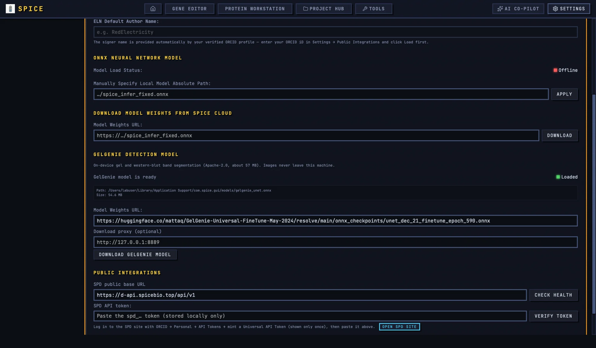

# Settings

Open **Settings** from the top navigation. The page has four categories: **General Settings**, **Gene Editor**, **Protein Workstation**, and **Keymap Settings**. Some changes apply immediately; others are written only when you click **Save All Configs**.

## 1. General Settings

### 1.1 Language

**Interface Language:** switches the interface immediately. The supported languages are Simplified Chinese, English, Japanese, Korean, German, Dutch, and Swedish. The selected language is stored locally and survives restarts. Documentation screenshots use English; select English if you want the labels in this guide to match the screen.

### 1.2 Theme

**Theme Palette:** chooses a color palette such as MIDNIGHT, OCEAN, FOREST, or ROYAL. **Display Mode:** chooses DARK, LIGHT, or SYSTEM. The display mode applies immediately; a changed color palette may need a reload to take effect in the current build.

### 1.3 ELN author

**ELN Default Author Name:** is read-only and disabled until an ORCID profile is loaded. It shows the verified ORCID display name and is used for ELN signing and the Project Hub PI prefill. To enable it, load an ORCID iD under **Public Integrations** first.

## 2. Models

### 2.1 SPICE ONNX model

The **ONNX Neural Network Model** section reports **Model Load Status** (`Loaded` or `Offline`), **Path**, **Size**, and **Output Heads**.

To use a local checkpoint:

1. Enter the absolute path in **Manually Specify Local Model Absolute Path**.
2. Click **Apply**. The app validates the file and loads it into the current process.
3. Check **Model Load Status** and **Output Heads**.

The manual path override is not persisted across restarts. The model file is never embedded in a project.

You can also set **Model Weights URL** and click **Download** to stream the checkpoint into the default model directory. The progress bar shows **Completed: X / Y**. The SPICE download path does not use the GelGenie SHA-256 check.

Without a model, the Protein Workstation reports an **ONNX** error instead of a fold. The app does not fabricate a desktop prediction.

### 2.2 GelGenie model

The **GelGenie detection model** section controls the model used by **AI detect (GelGenie)** in the gel and western-blot tools.

1. Leave **Model Weights URL** at the default unless your lab mirrors the model.
2. If your network requires a proxy, enter it in **Download proxy (optional)**.
3. Click **Download GelGenie model**.
4. Wait for the progress bar and the status **GelGenie model is ready**.
5. Check the displayed path and size. On macOS the default path is under `~/Library/Application Support/com.spice.gui/models/gelgenie_unet.onnx`.

The default URL is checksum-verified. A custom URL is downloaded without the default checksum check. Images never leave the machine; inference runs locally through ONNX Runtime.

### 2.3 Model files travel separately

Neither the SPICE checkpoint nor the GelGenie model is embedded in a `.spiceproj`. If you move a project to another computer, copy or download the models separately. The Project Hub document still opens, but AI detection and folding will report a missing model.

## 3. Public Integrations

### 3.1 SPD

**SPD public base URL** defaults to the public SPD API. A host-only URL is normalised to include `/api/v1`. **Check health** calls the health endpoint and reports service, status, and API version.

To authenticate:

1. Open the SPD site with **Open SPD site**.
2. Log in with ORCID.
3. Go to Personal → API Tokens and mint a Universal API Token.
4. Paste it into **SPD API token:** and click **Verify token**.
5. On success, the page shows **SPD identity: {name} (roles: {roles})**.

The token is stored locally. **Verify token** stores the token and base URL only after the identity call succeeds. **Save All Configs** writes the current fields even if they have not been verified.

### 3.2 ORCID

Enter an ORCID iD in the **ORCID iD** field and click **Load profile**. The app accepts a bare iD or an `orcid.org` URL and validates the checksum. On success it shows the credit name and institution and writes the author name for ELN signing.

The profile is re-fetched when Settings opens and when the Gene Editor mounts. There is no periodic refresh. If the public ORCID API is unreachable, signing is blocked until the profile resolves.

## 4. Gene Editor settings

### 4.1 Database syncs

The Gene Editor tab provides sync controls for:

- **REBASE** restriction enzymes.
- **CARD** antimicrobial-resistance genes.
- **IGSC** biosecurity toxin and pathogen motifs.

Each section shows the locally cached count and a sync button. A success message does not always prove a live network sync: in browser/demo mode, or when the backend fails, the app can fall back to a curated local dataset. Check the count and the activity log if the result matters.

### 4.2 Primer thermodynamics

The primer section exposes the default back-translation host and the monovalent, divalent, and primer concentrations used by the primer thermodynamics panel. The default host is *Escherichia coli*; the salt fields use molar units.

In the current build these values are stored by Settings but are not wired into every primer calculation. Verify the calculated Tm against your own protocol before ordering.

### 4.3 Gel export

**Gel Electrophoresis Export Super-Resolution Multiplier** offers 1×, 2×, 4×, and 8×. Higher multipliers increase export size and time. Use 2× for routine figures and 4× or 8× only when the journal requires a large raster image.

### 4.4 Gene preferences

- **Real-time Project Auto-Save:** saves gene-editor changes in the background. When a file path is known it saves silently; without a path it writes a local cache and clears the dirty flag. This is not a substitute for saving the `.spiceproj`.
- **Force Virtual Keyboard:** forces the on-screen DNA keyboard to appear in edit mode, even on desktop. Useful for touch devices and demonstrations.

### 4.5 Custom enzyme sets

**Backup & Export Custom Enzyme Sets** writes a JSON file with your named enzyme sets. **Import External Enzyme Sets** expects an array of `{name, enzymes: []}` objects and merges by name; an imported set with the same name replaces the existing one.

## 5. Protein Workstation settings

The Protein Workstation tab exposes:

- **Physical Integration Step (fs):** 1.0, 2.0, or 4.0 fs. The 4.0 fs option requires virtual hydrogen-bond constraints.
- **Temperature Coupling Damping Constant (ps):** default 0.1.
- **Clashing Water Cutoff Radius (Å):** default 2.2.
- **Potential Energy Thermal Fluctuation Multiplier (M1):** default 1.4826.

These are engine defaults. In the current build the Settings page stores them, but the running engine may use its own compiled defaults. Record any non-default values in your methods if you depend on them.

## 6. Keymap Settings

The keymap editor rebinds the Gene Editor's shortcuts.

- Click **Record**, then press the key combination.
- Modifiers include Ctrl, Alt, Shift, and macOS Command, shown uniformly as **Mod**.
- Press `Esc` during recording to cancel without changing the binding.
- Global shortcuts are muted while focus is in a text input, editor, or console.

Categories are **View & Navigation**, **Edit, Save & Undo**, and **Molecular Cloning & Analysis Panels**. Each row shows the name, description, current binding, and buttons **Record**, **Clear**, and **Default**.

If a binding conflicts with another action, the row shows **Conflict: Duplicated with "{name}"** and a warning toast. The conflict is not reverted automatically; choose a different key or clear the other binding.

**All Reset to Default** restores every binding. Bindings persist only after **Save All Configs**.

Default bindings include `Mod+Z` undo, `Mod+Shift+Z` redo, `Mod+S` save, `Mod+R` reset, `Escape`, and the view/tool shortcuts listed in the editor. `Mod` means Command on macOS and Ctrl elsewhere.

## 7. Save semantics

| Setting group | When it is saved |
|---|---|
| Language, display mode | Immediately. |
| Theme palette | Stored immediately; may need reload to render. |
| SPICE model path | Current native process only. |
| SPICE model URL, GelGenie URL/proxy | On download or **Save All Configs**, depending on the field. |
| SPD base URL/token | On successful verify/health, or **Save All Configs**. |
| ORCID | On successful profile load. |
| Keymap, gene defaults, primer values, gel multiplier, autosave, virtual keyboard, protein engine defaults | On **Save All Configs**. |

All settings live in the WebView's local storage, not in a cloud account or a settings file. Clearing application data resets them.

## 8. Security notes

- AI API keys, SPD tokens, MCP environment JSON, memory entries, and audit logs are stored unencrypted in local storage.
- Clear credentials before handing a workstation to another person.
- A remote AI endpoint receives the conversation and injected context under that provider's policy.
- The ELN signature is an unkeyed SHA-256 digest, not a certified electronic signature. Follow your institution's records policy.

For the surrounding workflows, see [Getting started](getting-started.md), [Project Hub](project-hub.md), and [AI Co-Pilot](ai-copilot.md).
