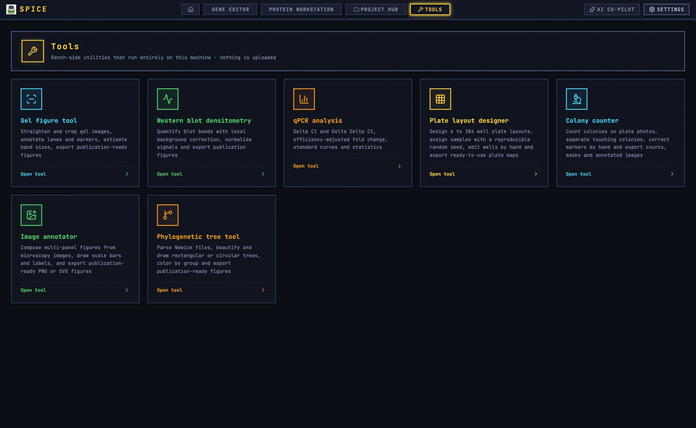

# Bench Tools

The **Tools** workspace contains eight focused editors for the measurements and figures that sit between experiments. Each tool runs locally, keeps its own working state, and can also live inside a SPICE project.

| Tool | Page | Use it for |
|---|---|---|
| **Gel figure tool** | [Gel figure tool](gel.md) | Agarose and SDS-PAGE figures, lane/band detection, ladder sizing, publication layout. |
| **Western blot densitometry** | [Western blot](blot.md) | Band quantification, background correction, normalization, group statistics. |
| **qPCR analysis** | [qPCR](qpcr.md) | ΔΔCt and standard-curve analysis with QC flags. |
| **Plate layout designer** | [Plate layout](plate.md) | Randomised or structured 6–384-well plate maps. |
| **Colony counter** | [Colony counter](colony.md) | Colony counts, size statistics, CFU/mL, blue/white classification. |
| **Image annotator** | [Image annotator](annotate.md) | Multi-panel microscopy figures with labels, scale bars, and profiles. |
| **Phylogenetic tree tool** | [Phylogenetic tree](tree.md) | Newick trees, layouts, metadata, support values, and tree comparison. |
| **Figure Studio** | [Figure Studio](figure.md) | General publication figures with charts, images, vectors, and compliance checks. |

## Common workflow

Every bench tool follows the same broad pattern:

1. **Open the tool** from the Tools hub, or open one of its documents from the Project Hub.
2. **Import the raw data** — an image, a CSV/TSV file, a Newick string, or pasted text.
3. **Configure detection or analysis** and run it.
4. **Inspect and correct** the automatic result. These tools are designed for manual review; no detector is trusted blindly.
5. **Export** the result, the figure, the CSV, and a project file or project document.
6. **Save to the project** when the result belongs to an experiment, and export a reproducibility bundle when the result needs a portable audit trail.

## Standalone versus project mode

A tool opened from the Tools hub is **standalone**. Its durable record is the tool's own project file (JSON) plus the exported results. A tool opened from the Project Hub is a **project document**; the tool saves back into the open `.spiceproj` through the project bar. In project mode, `Ctrl`/`Cmd`+`S` saves the active document where the tool supports it.

The project document stores the editable payload. The exported CSV, SVG, PNG, TIFF, or PPTX is the result you share. Use both: the document to reopen the analysis, the export for the lab notebook or manuscript.

## Autosave and durability

Each tool restores its last working state from local storage after a reload. That autosave is a convenience, not a backup. It does not travel with the project and may omit the original image to control size. Save the project document or project JSON for anything you need to keep.

## Reproducibility bundles

Tools that offer a **Repro bundle** export a ZIP with:

- The result files for that tool, such as an annotated PNG, figure SVG, or results CSV.
- `project.json` with the editable payload.
- `parameters.json` with the tool name, title, generation time, and parameters.
- `methods.md` with generated methods text.
- `software.json` with the app version, platform, locale, and generation time.
- `README.md` describing the bundle.
- `manifest.sha256.json` listing each file, its MIME type, byte size, and SHA-256 hash.

The manifest lets another person verify that the files have not changed. It does not replace the raw data or the instrument export.

## Sending results to Figure Studio

Most tools have **Send to Figure Studio**. It places the current figure or chart into a temporary session handoff and opens Figure Studio. The handoff is one-way and expires after ten minutes; panels are copied as images, not linked back to the source analysis. If the underlying analysis changes, send the panel again.

## Batch modes

| Tool | Batch limit | Output |
|---|---|---|
| Gel figure | 60 images | Per-image PNG, project JSON, and summary CSV in a ZIP. |
| Western blot | 40 images | Per-image annotated PNG, densitometry CSV, and `summary.csv`. |
| Colony counter | 40 plates | Per-image annotated PNG, markers CSV, and `summary.csv`. |

Batch modes use the saved default detection settings, not per-image manual corrections. Spot-check the summary and individual images before pooling results.

## Shared samples and plate maps

Plate layout and qPCR share a sample vocabulary. The plate-map columns are `well,sample,group,type,replicate`. A qPCR input converted from a plate map uses `well sample target ct group replicate`. This is the safest way to carry sample names from design to analysis without retyping.

## GelGenie AI detection

The gel and western-blot tools provide **AI detect (GelGenie)** in addition to their classical detectors. It requires:

1. The desktop build.
2. The GelGenie model downloaded once in **Settings → General Settings → GelGenie detection model**.
3. A moment for the first inference to load the model.

The model returns band masks and lane clusters. It is a second opinion, not a replacement for inspecting the image, correcting lanes, and fitting the ladder. Images never leave the computer.

## Tool-specific guides

- [Gel figure tool](gel.md)
- [Western blot densitometry](blot.md)
- [qPCR analysis](qpcr.md)
- [Plate layout designer](plate.md)
- [Colony counter](colony.md)
- [Image annotator](annotate.md)
- [Phylogenetic tree tool](tree.md)
- [Figure Studio](figure.md)
