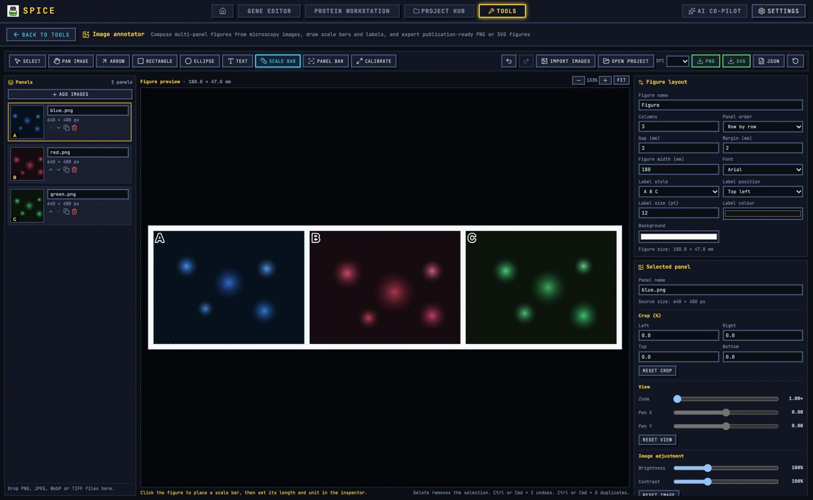

# Image Annotator

The Image annotator builds multi-panel microscopy figures: import images, crop and arrange panels, calibrate scale bars, draw labels and arrows, and export PNG or SVG at a chosen DPI.

## 1. When to use it

Use it for a microscopy figure that needs panel letters, scale bars, arrows, and consistent layout. For a gel or blot panel, use the dedicated tools and send the result to [Figure Studio](figure.md). For a mixed figure with charts and diagrams, use Figure Studio.

## 2. Import panels

1. Open **Tools → Image annotator**.
2. Click **Import images**, or drop PNG, JPEG, WebP, or TIFF files onto the page.
3. The `Panels` list shows `n panels`.

Each panel has a name (default `Image 1`, with `copy` added on duplication), move up/down, duplicate, and remove. Panels are laid out automatically; the `Figure layout` panel controls the grid.

## 3. Per-panel settings

Select a panel to edit it.

- `Source size` reports the imported dimensions.
- `Crop`: left, right, top, bottom, `Reset crop`.
- `View`: `Zoom`, `Pan X`, `Pan Y`, `Reset view`. This is a view transform, not a destructive crop; it lets you show a region of interest within the panel.
- `Image adjustment`: `Brightness`, `Contrast`, `Reset image`.
- `RGB channels`: per-channel `Show`, `Invert`, and `Gain` (0–2), with `Reset channels`. Hidden channels are excluded from previews, annotations, and exports.

Record every display adjustment in the figure legend. Adjusting brightness or contrast across panels differently can create a misleading comparison.

## 4. Calibration and scale bars

Calibration is stored per panel.

1. Select a panel.
2. In `Calibration`, set `Calibration unit` (for example µm or nm).
3. Enter `Known length`.
4. Click `Draw line` and drag across a feature of that known length.
5. The panel reports `Calibration saved`, or `Calibration line is too short` if the line is unusable.
6. `PxPerUnit` shows the resulting scale.

If a panel is not calibrated, `annotNotCalibrated` appears and a calibrated scale bar cannot be attached. Use `Clear calibration` to redo it.

The `Scale bar` tool places a bar on the figure; in the inspector, choose `Bar mode` `Calibrated` or `Fixed length`, set `Value`, `Unit`, `Bar thickness`, and `Show label`. `Panel bar` attaches a bar to a specific calibrated panel. Use the calibrated mode for publication; a fixed-length bar is easy to get wrong if the display scale changes.

## 5. Layout and typography

`Figure layout`:

- `Columns` and `Panel order` (`Row by row` or `Column by column`).
- `Gap` and `Margin`.
- `Figure width` in mm.
- `Label style` (`A B C`, `a b c`, `1 2 3`).
- `Label position` (six corners).
- `Label size`, `Label colour`.
- `Background`, `Font`, `Figure name`, `Figure size` (mm).

A typical single-column figure is 85–90 mm wide; a double-column figure is 170–180 mm. Keep panel letters at least 7–8 pt at final size.

## 6. Drawing tools

The toolbar has `Select`, `Pan image`, `Arrow`, `Rectangle`, `Ellipse`, `Text`, `Scale bar`, `Panel bar`, `Calibrate`, and `Profile`.

- `Select`: click a panel or annotation, drag to move, drag handles to resize.
- `Pan image`: drag inside a panel to reposition the zoomed image.
- `Arrow`: drag from tail to head; hold `Shift` to constrain the angle.
- `Rectangle` / `Ellipse`: drag to draw.
- `Text`: click to place, then edit in the inspector.
- `Scale bar` / `Panel bar`: see above.
- `Calibrate`: drag a known-length line for the selected panel.
- `Profile`: drag along the figure to sample an intensity profile.

Annotation inspector fields: `X`, `Y`, `Width`, `Height` (or `X1/Y1/X2/Y2` for lines), `Colour`, `Stroke`, `Fill`, `Filled`, `Opacity` where relevant; text has `Text`, `Font size`, `Background`, `Padding`; scale bars have `Bar mode`, `Value`, `Unit`, `Thickness`, `Show label`.

`Delete` removes the selection; `Ctrl/Cmd+Z` undoes; `Ctrl/Cmd+D` duplicates. The annotation list can select and delete individual objects.

## 7. Intensity profile

The `Profile` tool samples evenly spaced points along a drawn line from the rendered RGB composite. Set `Samples` between 16 and 1024. It reports line length, min/mean/max, and a chart. `Profile CSV` exports the sampled values.

A profile from a rendered composite is affected by display adjustments and channel gain. For quantitative intensity, measure on the raw channel data in your analysis package; use this tool for figure annotation and a quick sanity check.

## 8. Export

- **PNG** at the chosen `DPI`.
- **SVG** with vector annotations and embedded raster panels.
- **Project JSON** with panels, crops, calibration, and annotations.
- **Repro bundle** with the figure, project, and supporting files.

`Export` refuses with `Add at least one panel before exporting` when the canvas is empty. The project autosaves locally; if autosave fails because storage is full, export the project JSON.

For journal submission, export at 300 dpi or higher and check the final physical size. SVG is preferable when the journal accepts vector figures, but the microscopy images remain raster inside it.

## 9. Worked example: three-panel microscopy figure

1. Import three images: control, treatment, and a zoomed detail.
2. Crop each to the same region and remove scale-bar burn-ins you plan to replace.
3. Calibrate each panel with its original scale bar or a stage micrometer.
4. Set two columns, row-by-row order, a 2 mm gap, and a 90 mm figure width.
5. Set label style `A B C` at 8 pt, top left.
6. Attach a calibrated scale bar to each panel, with a single unit and consistent thickness.
7. Add text labels or arrows for the structures of interest.
8. Check that brightness and contrast are comparable across panels.
9. Export PNG at 300 dpi and SVG.
10. Export the project JSON and repro bundle, and cite the calibration source in the caption.

## 10. Caveats

- Calibration is per panel; a copied panel keeps the source calibration, so recheck it.
- The view zoom and pan are display transforms; they do not change pixel data.
- Channel gain and inversion affect the exported figure.
- Profiles are sampled from the composite, not the raw channels.
- Vector export keeps annotations as vectors but embeds images as rasters.
- Autosave is local; the project JSON is the durable record.

For shared tool concepts, see [Bench tools](README.md). For mixed figures, see [Figure Studio](figure.md).
