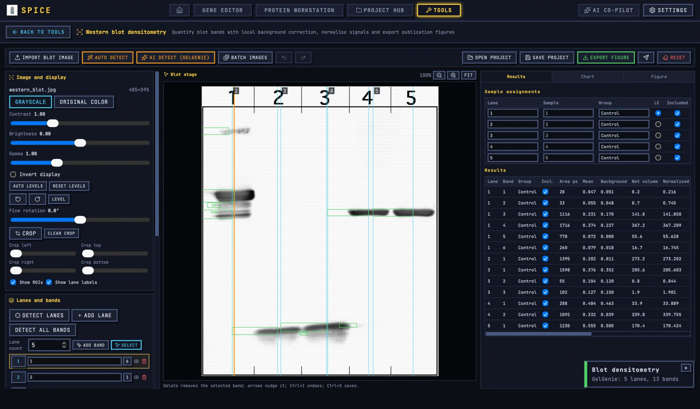

# Western Blot Densitometry

The Western blot tool detects lanes and bands, subtracts local background, normalizes signals, computes group statistics, and exports a quantified figure.

## 1. When to use it

Use this tool when you need a number from a blot, not just a picture: fold change, normalized band volume, a group comparison, or a figure with individual data points. For a simple gel photograph without quantification, use the [Gel figure tool](gel.md).

## 2. Import and prepare

1. Open **Tools → Western blot densitometry**.
2. Import the blot image.
3. Crop to the membrane, excluding labels, empty membrane, and scanner borders.
4. Choose grayscale or original colour.
5. Adjust brightness, contrast, gamma, and inversion if needed.

Crop tightly. Lanes and bands outside the analysis region only create false detections. Do not use contrast to hide background; background correction happens later.

## 3. Detect lanes and bands

### 3.1 Auto detect

Click **Auto detect**. The classical detector uses the inverted grayscale profile, finds lane peaks, then detects bands within each lane.

The defaults are tuned for ordinary blots:

- Outer 2% of the image width is trimmed.
- The lane baseline uses a 10% window.
- Peak prominence is 0.8 standard deviations.
- Minimum lane gap is 3% of the image width.
- Lane width is derived from the median lane gap.
- Bands use a 12% height baseline, 0.62 standard deviation prominence, and a 0.8% minimum gap.
- Up to 24 bands per lane.

The detector expects dark bands on a light background. For a fluorescent blot with bright bands on a dark background, invert the display or use the correct polarity setting before detection.

### 3.2 AI detect (GelGenie)

Click **AI detect (GelGenie)** for the neural segmentation model. It requires the desktop build and the GelGenie model downloaded in Settings.

The model handles the polarity automatically: it detects a light background and inverts the input, or leaves a dark background unchanged. It returns band boxes and lane clusters.

After either detector:

1. Check the lane count.
2. Delete spurious bands.
3. Add missed bands.
4. Adjust band boxes.
5. Rename lanes and assign samples and groups.

### 3.3 Lane count and manual lanes

The lane count control accepts 1–40 lanes. If the automatic count is wrong, set the count and let the tool distribute lanes evenly. This preserves existing lane names, samples, groups, and bands where possible.

Manual lane placement is the fallback when lanes are uneven or the image has a strong smile. Correct lane geometry before trusting per-lane band volumes.

## 4. Assign samples and groups

For each lane, fill in:

- Lane name.
- Sample.
- Group.
- Loading-control flag or selection.

Group assignment drives the control comparison. The control group is the denominator for fold change. If no control group is set, fold change has no meaning.

## 5. Background models

Choose a background model in the analysis panel:

| Model | When to use it |
|---|---|
| **Ring** | Default. A ring around each band estimates local background. Good for clean blots with even background. |
| **Lane** | Estimates background from the lane. Useful when the membrane background varies by lane. |
| **Global** | One background for the whole image. Use only for a very even membrane. |
| **Manual** | Enter a measured background. Use when you have a defined local background value. |

Background choice materially changes low-signal bands. Record the model in your methods. Do not switch models between groups to make a result look better.

## 6. Normalization

The tool supports:

- **Loading control** — divide the target band volume by the loading-control band volume in the same lane.
- **Total protein** — divide by the lane or membrane total signal.
- **None** — compare raw net volumes.

For phospho/total blots, use the total protein band as the loading control. For a classic loading control such as GAPDH or β-actin, select that band per lane.

Normalization is not a correction for a bad loading. If the loading control varies by more than the target effect, fix the experiment, not the analysis.

## 7. Results

The **Results** tab reports per band:

- Lane, band number, sample, group.
- Included/excluded state.
- Area, mean, background, net volume.
- Saturation flag.
- Normalized value and fold change.
- Group mean, SD, SEM, 95% CI, p value, and n.

Group statistics use a Welch t-test against the control group, so unequal variances are allowed. The confidence interval is a Student t interval.

### 7.1 Saturation

A band is flagged when the saturated pixel fraction exceeds 0.005. Saturation is a warning, not a correction. A saturated band has lost its upper dynamic range and should not be used for quantitative comparison. Re-expose the blot or exclude the band.

### 7.2 Exclusions

You can exclude a band or lane without deleting it. Exclusions change n and the statistics; recheck the p value and the group summary after every exclusion. State the exclusion rule in your methods.

## 8. Chart and figure

The **Chart** tab builds a bar or scatter chart of the normalized results. Show individual points when n is small; a bar with only mean ± SEM hides the replicate spread.

The **Figure** tab composes the annotated blot and chart for export. Include:

- The blot with lane labels and ROI outlines.
- The normalization method.
- Group labels.
- n and the statistical test.
- A caption that states what the error bars represent.

Export the figure as SVG when possible, or PNG at 300 dpi. The annotated PNG is useful for the lab notebook; the SVG is better for publication.

## 9. Exports

- **Annotated PNG** with ROI outlines and labels.
- **Figure SVG** for publication assembly.
- **Densitometry CSV** with well-level results, group summaries, QC flags, and statistics.
- **Repro bundle** with the figure, CSV, project, parameters, methods, and SHA-256 manifest.
- **Batch ZIP** for up to 40 images: per-image annotated PNG, densitometry CSV, and `summary.csv`.

The CSV uses a UTF-8 BOM and CRLF line endings for Excel compatibility.

## 10. Worked example: phospho-AKT / total AKT

1. Import the blot and crop to the membrane.
2. Click **Auto detect**. If the five-lane pattern is wrong, use **AI detect (GelGenie)** or correct the lanes manually.
3. Assign samples: control and treated, with three biological replicates.
4. Mark the total AKT band as the loading control for each lane.
5. Choose the **Ring** background model.
6. Enable loading-control normalization.
7. Set the control group.
8. Review the Results tab. Exclude saturated bands and explain why.
9. Check that the group n is correct after exclusion.
10. Open Chart, show individual points, and label the error bars.
11. Open Figure, add the blot and chart, and export SVG/PNG.
12. Export the CSV and repro bundle.
13. Save the blot document into the project.

## 11. Detection and quantification caveats

- The classical detector assumes dark bands on a light background.
- Up to 24 bands per lane; crowded lanes may need manual splitting.
- Lane count is capped at 40.
- The ring model is a local estimate, not a rolling-ball background.
- Saturation is flagged, not repaired.
- A band at the detection limit has a large relative error; do not over-interpret small fold changes.
- Batch mode uses the saved default settings, not per-image corrections.
- AI detection is a second opinion, not a replacement for visual inspection.

For shared tool concepts, see [Bench tools](README.md). For the gel figure workflow, see [Gel figure tool](gel.md).
