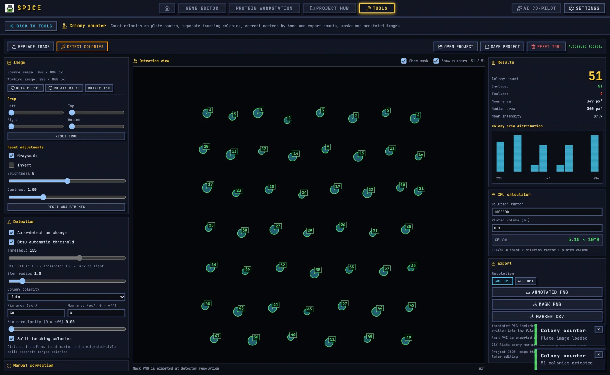

# Colony Counter

The Colony counter measures colony-forming units on plate photographs, separates touching colonies, supports manual correction, and exports counts, masks, annotated images, and statistics.

## 1. When to use it

Use it when you need a count from a plate photo: transformation efficiency, CFU/mL, blue/white screening, or a plating-series comparison. For a plate map before plating, use the [Plate layout designer](plate.md).

## 2. Import an image

1. Open **Tools → Colony counter**.
2. Click **Import plate image**, or drop a PNG, JPEG, WebP, or TIFF anywhere on the page.
3. If a project is open, open the colony document from the Project Hub instead.

The image panel shows `Source image: w × h px`. Large images are processed with a working limit of 4096 px; detection is capped at 1400 px and results are mapped back to the original coordinates. The cap limits small-colony resolution on very large photos; crop first if you need every speck.

## 3. Prepare the image

Controls: `Rotate left`, `Rotate right`, `Rotate 180`, `Crop` (left/top/right/bottom), `Reset crop`, `Grayscale`, `Invert`, `Brightness`, `Contrast`, and `Reset adjustments`.

Crop to the agar surface and exclude the dish rim, labels, and bench background. A dark rim is a common source of false colonies. If the plate is illuminated unevenly, a mild background flattening in an external image editor is better than extreme contrast here.

## 4. Detection

The **Detection** panel has `Detect colonies` (or `Auto-detect on change`) and these parameters:

| Parameter | Meaning |
|---|---|
| Threshold | Binary threshold; `Otsu automatic threshold` computes it and reports `Otsu value`. |
| Blur radius | Smooths noise before thresholding. |
| Colony polarity | `Auto`, `Dark on light`, `Bright on dark`. |
| Min area (px²) | Discards specks. |
| Max area (px², 0 = off) | Discards merged blobs or artefacts. |
| Min circularity (0 = off) | Rejects elongated dust and streaks. |
| Split touching colonies | Distance transform, local maxima, and a watershed-style split. |

A practical order is: set polarity explicitly if Auto is wrong, use Otsu, then raise `Min area` until dust disappears, then enable splitting for confluent regions.

`Split touching colonies` is an estimate. Very dense plates undercount even with splitting; count by serial dilution instead.

## 5. Manual correction

- Click empty space to add a colony.
- Click a marker to include or exclude it.
- Drag a marker to move it.
- The selected marker shows `Marker #id`, `Area`, `Mean intensity`, and `Circularity`, with `Include`, `Exclude`, `Delete marker`.
- `Clear all markers` removes everything; `Reset exclusions` includes all again.
- `Manual markers: N` counts your additions.

Included, excluded, and manual markers have distinct legend colours. Excluded markers remain in the export so a reviewer can see what was rejected.

## 6. Results and CFU

The **Results** panel reports `Colony count`, `Included`, `Excluded`, `Mean area`, `Median area`, `Mean intensity`, and an area-distribution histogram.

For CFU/mL, enter `Dilution factor` and `Plated volume (mL)`:

`CFU/mL = count × dilution factor ÷ plated volume`

The result includes a Poisson 95% confidence interval, also shown for the raw count. Use the included count, and state the dilution and volume in your methods.

## 7. Blue/white screening

`Colony color classification` can be `Off` or `Blue/white`. It measures mean RGB and hue per marker.

- Blue and white counts appear as `Blue N · White N · Unclassified N`.
- Grayscale images cannot be classified; the panel says so.
- You can set the class manually for the selected marker.

Colour classification is sensitive to white balance and illumination. Photograph all plates in a series under the same conditions, and check the unclassified fraction.

## 8. Exports

- **Annotated PNG** with rings and numbering; the chosen DPI is written into the file metadata.
- **Mask PNG** at detector resolution.
- **Marker CSV** listing every marker, including excluded ones.
- **Statistics CSV** with the Poisson confidence interval and CFU/mL.
- **Project JSON** with image, settings, and markers.
- **Repro bundle** with the annotated PNG, mask, marker CSV, statistics, and project JSON.

`Send to Figure Studio` places the annotated plate into a multi-panel figure.

## 9. Batch count

`Batch count` processes up to 40 plate images in one ZIP using the current detection settings. It does not apply per-image corrections, so use it only for a consistent imaging series. Review the per-plate counts and spot-check images before reporting.

## 10. Worked example: transformation efficiency

1. Plate 100 µL of a 1:10 dilution on an ampicillin plate.
2. Photograph the plate evenly; avoid glare and shadow.
3. Import, rotate upright, crop to the agar.
4. Set polarity and Otsu threshold; detect.
5. Enable splitting if colonies touch.
6. Correct false positives at the rim and in dust.
7. Enter dilution factor 10 and plated volume 0.1 mL.
8. Read CFU/mL and the 95% CI.
9. Export the annotated PNG, marker CSV, statistics CSV, and repro bundle.
10. Save the colony document into the project.

## 11. Caveats

- Dense plates undercount; dilute and recount.
- The automatic threshold is a starting point, not a validated method.
- The 1400 px detection cap limits tiny-colony detection on large images.
- Colour classification depends on illumination and white balance.
- Batch mode uses one setting for all plates.
- Excluded markers stay in the CSV; filter on the include flag before analysis.
- A colony count is not a viability measurement; it counts visible colonies.

For shared tool concepts, see [Bench tools](README.md). For figure assembly, see [Figure Studio](figure.md).
