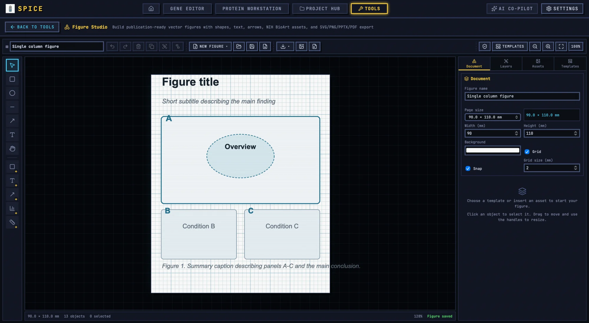

# Figure Studio

Figure Studio assembles publication figures from images, charts, diagrams, arrows, text, and scale bars. It exports vector SVG, raster PNG/TIFF, PDF, and editable PPTX.

## 1. When to use it

Use Figure Studio when the figure is more than one panel: a gel plus a blot plus a quantification chart, a microscopy series with a diagram, or a graphical abstract. For a single gel or blot, the dedicated tools produce a better panel faster, and they can send it here.

## 2. Start a figure

`New figure` offers page presets:

| Preset | Size |
|---|---|
| Single column | 90 × 120 mm |
| Double column | 180 × 120 mm |
| Slide 16:9 | 338.7 × 190.5 mm |
| Poster A0 | 841 × 1189 mm |
| Square | 120 × 120 mm |

`Open figure` loads a Figure Studio document. `Save` and `Save as` write the project JSON. The document panel also exposes `Page size`, `Width`, `Height`, `Background`, `Figure name`, and `Grid size`; grid and snap can be toggled from the toolbar.

Templates set up a layout quickly: `Single column`, `Double column`, `Slide 16:9`, `Graphical abstract`, `Mechanism`, `Workflow`, `Comparison`, and `Timeline`. A template is a starting arrangement; every element remains editable.

## 3. Canvas tools

Toolbar: `Select`, `Rectangle`, `Ellipse`, `Arrow`, `Line`, `Text`, `Path`, `Pan`, plus `Zoom in`, `Zoom out`, `Fit`, `Actual size`, `Grid`, `Snap`.

- Click to select; drag to move; use handles to resize. Hold `Space` to pan with any tool.
- `Group`/`Ungroup`, `Duplicate`, `Delete`, `Copy`/`Paste`, `Copy style`/`Paste style`.
- `Move up`/`Move down`, `Bring to front`/`Send to back`, `Lock`/`Unlock`, `Show`/`Hide`.
- `Undo`/`Redo`.

The inspector edits `X`, `Y`, `Position`, `Size`, `Rotation`, `Opacity`, `Fill`, `Stroke`, `Stroke width`, `Dash`, and `Corner radius`. Text adds `Font`, `Font size`, `Bold`, `Italic`, `Alignment`, `Colour`, `Line height`. Image objects add `Fit mode`, `Flip horizontally`, `Flip vertically`, `Crop`, and `Lock aspect ratio`. Paths and arrows add `Closed path`, `Arrow at start`, `Arrow at end`, and `Arrow size`.

The status bar reports the object count and selection count. If the page 1 canvas is hidden behind other panels, use the `Pages` control.

## 4. Assets

`Assets` is a searchable library with categories and licence notes. Search, choose an asset, and `Insert asset`. `Check each asset's licence before publication` is a reminder, not a clearance. `Export citations` writes the asset citation block for the figure legend or references. The asset inspector records `Creator`, `Credit`, `Citation`, and `Asset` name.

For your own images, use `Import image`. Images can be cropped non-destructively and fitted to a frame. Keep the original file; the project embeds a working copy.

## 5. Charts

`Chart` creates a bar, line, or scatter chart from CSV data.

- The first column is the category.
- Headers ending in `err` become error bars.
- Set `X axis label`, `Y axis label`, `Y range` (`Auto` or explicit), `Legend`, `Grid`, `Values`, `Error bars`.
- `Add significance bracket` takes `From`, `To`, and `Label`.
- `Load example` inserts a working dataset; `Could not read chart data` means the CSV shape is wrong.

Chart text follows the object font settings. Use `Values` sparingly; a bar chart with individual points is usually more honest for small n. Significance brackets should name the test and the comparison in the caption.

## 6. Import diagrams

`Import Mermaid` accepts Mermaid `flowchart`/`graph` code and converts it to vector shapes; other Mermaid diagram types are imported as a vector image. `Import SVG` accepts an SVG file or pasted markup. Choose `Insert into current figure` or `New figure`, then `Import`.

Some SVG features are not convertible; the dialog reports how many elements were skipped. Check the result rather than assuming a one-to-one import.

## 7. Scale bars

The `Scale bar` object has `Label`, `Thickness`, `End caps`, and its own geometry. For images, set the label from the known pixel size of the source. Figure Studio does not know microscope calibration; it draws the bar you specify.

## 8. Publication check

`Check → Run check` reports:

- Text below 6 pt (journals usually require at least 6 pt).
- Text so small it may be unreadable.
- Strokes below 0.25 pt.
- Images rendering below 300 dpi, and below 150 dpi.
- Chart series colours that are hard to distinguish.
- Text that may overflow its box.

`No issues found for the current checks` means the automated checks passed, not that the figure is publication-ready. Check panel alignment, consistent fonts, colour-blind safety, and caption accuracy yourself.

## 9. Export

- **SVG** with vector shapes and real text.
- **PNG** at 300 dpi.
- **TIFF** at 300 dpi for journals that require a raster master.
- **PDF** at 300 dpi.
- **PPTX** with editable shapes and text.
- **Citations** for used assets.

Export uses the page size in millimetres. Before exporting, check the target journal's width, font, and file-format requirements. A 90 mm figure with 6 pt text is not the same as a 180 mm figure scaled down later.

## 10. Worked example: multi-panel result figure

1. Start from `Double column` (180 mm).
2. Import a gel panel from the gel tool and a blot panel from the blot tool via `Send to Figure Studio`.
3. Add a bar chart from the densitometry CSV; set error bars and a significance bracket.
4. Arrange panels in two rows with equal margins; use `Snap`.
5. Add `A`, `B`, `C` labels at 9 pt bold.
6. Add a scale bar to the microscopy panel with the correct unit.
7. Set one font family and one palette across the figure.
8. Write the title and caption; state n, error bars, and the statistical test.
9. Run `Publication check`; fix font, dpi, and colour warnings.
10. Export SVG for submission and PNG 300 dpi for review.
11. Save the project and export the asset citations.

## 11. Caveats

- Sent panels are images, not live links; resend after changing the source analysis.
- Figure Studio does not know microscope calibration.
- The asset licence note is a reminder, not legal advice.
- SVG import may skip unsupported elements.
- Raster exports are 300 dpi; very large pages may be memory-intensive.
- PPTX is editable but may not match the SVG exactly.
- Publication check covers geometry and dpi, not scientific correctness.

For shared tool concepts, see [Bench tools](README.md). For the source panels, see [Gel figure tool](gel.md), [Western blot densitometry](blot.md), and [Image annotator](annotate.md).
