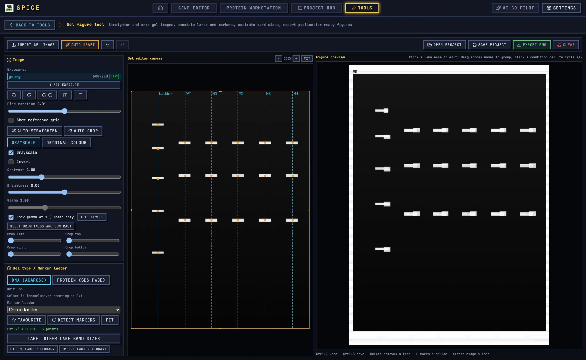

# Gel Figure Tool

The Gel figure tool turns an agarose or SDS-PAGE image into a labelled, sized, publication-ready figure. It handles orientation, exposure, lane and band detection, marker calibration, annotations, and export.

## 1. When to use it

Use this tool when the figure is primarily a gel: genotyping PCR, restriction digest, SDS-PAGE, or a simple presence/absence gel. If the figure combines a gel with microscopy, blots, charts, and diagrams, build the gel panel here and send it to [Figure Studio](figure.md).

## 2. Import an image

1. Open **Tools → Gel figure tool**.
2. Click **Import gel image**.
3. Choose a PNG, JPEG, BMP, WebP, GIF, or TIFF file. TIFF is decoded by the tool rather than the browser.
4. If a project is open, open the gel document from the Project Hub instead of starting standalone.

The tool keeps recent images and a local working state. A named project file is the durable record.

## 3. Correct the image

The image panel provides:

- Rotate 90° left or right.
- Mirror horizontally or vertically.
- Fine rotation for a skewed gel.
- Crop.
- Brightness, contrast, and gamma.
- Grayscale or original colour.
- Stain preset and detection channel.
- Display inversion.

A practical order is: rotate to upright, crop out the container edges and labels you do not want, then adjust exposure. Do not over-contrast a faint band into existence; a band that is below the image's dynamic range is not recoverable.

### 3.1 Stain presets

The detection preset offers:

- **Auto**
- **UV / ethidium bromide**
- **SYBR Green**
- **Coomassie blue**
- **Silver stain**

Each preset selects a channel and polarity appropriate to the stain. The channel options are Auto, Luma, Red, Green, Blue, Red-Blue, and Green-Red. The polarity options are Auto, Bright, and Dark. If the automatic choice is wrong, set the channel and polarity explicitly.

## 4. Auto draft

Click **Auto draft** for a first pass. It runs three steps:

1. Estimate and apply the straightening angle.
2. Find the gel area and crop to it.
3. Detect lanes and bands.

Auto draft is deterministic for a given image and settings. It is a starting point. Inspect the crop, lane count, and band boxes before accepting the result.

## 5. Detection settings

The detection panel exposes sensitivity, denoise, lane and band thresholds, smoothing, and minimum widths. The defaults are designed for ordinary agarose gels:

- Sensitivity 0.35.
- Denoise 1.
- Lane cut 0.08.
- Lane merge gap 0.005.
- Minimum lane width 0.004.
- Lane smoothing 0.02.
- Lane prominence 0.1.
- Band prominence 0.5.
- Band minimum gap 0.006.
- Band smoothing 3.

Raise sensitivity or lower prominence to catch faint bands; raise the minimum area or prominence to suppress texture and speckles. Change one parameter at a time and compare the result.

## 6. Lanes and bands

### 6.1 Lane detection

Run lane detection from the lane panel. Check that the count equals the number of loaded wells, including the ladder and the no-template control. A lane that is missed usually means the lane is faint, the crop includes a dark border, or the lane width is outside the expected range.

You can add, delete, rename, hide, and reorder lanes. Mark the ladder lane as the marker lane before sizing.

### 6.2 Band detection

Run band detection for all lanes or for one lane. Inspect each band:

- Delete spurious bands caused by texture, dye fronts, or shadows.
- Add missed bands by clicking in the lane.
- Adjust the band height and width if the automatic box is too large.
- Rename or hide bands that should not appear in the figure.

The gel editor asks before a bulk redetect overwrites manually edited bands. If you have made a lot of corrections, export or save before redetecting.

## 7. Marker calibration and band sizing

1. Select the marker lane.
2. Choose the ladder from the built-in catalogue. The catalogue contains DNA and protein ladders; the default project uses the `gr1kb` DNA ladder.
3. Fit the marker bands. The tool matches detected bands to the known ladder sizes.
4. Review the fit and R².
5. Estimate sizes for the sample bands.

The sizing model fits log10(size) against migration position. A poor R² usually means the wrong ladder, a misassigned marker band, or a gel with a strong smile. Correct the marker assignment before trusting sample sizes.

For a new ladder, create a custom ladder entry rather than forcing a closest match.

## 8. Figure composition

The figure panel controls the layout that will be exported:

- Figure width in millimetres. The default is 120 mm.
- Lane labels, group headers, and condition rows.
- Font family, primary and secondary font sizes, and colours.
- Title and caption.
- Band labels and size annotations.
- Crop and margins.
- Visible lanes and bands.

A typical publication figure uses a 90 mm single-column or 180 mm double-column width. Keep the final font size at or above the journal's minimum, often 6–8 pt.

Use the pre-flight check before export. It reports clipping, effective dpi, font size, and ladder-fit issues. Fix warnings before generating the final file.

## 9. Export

The export menu provides:

- **PNG** with pHYs DPI, sRGB, and iTXt metadata.
- **TIFF** for journals that require a raster master.
- **SVG** for vector text and shapes.
- **PPTX** for presentations.
- **Uncropped image** with annotations.
- **Original image** without annotations.
- **Processing log** with the operations applied.
- **Repro bundle** with the figure, project, parameters, methods, and SHA-256 manifest.
- **CSV** with lane, marker, band, position, size, unit, approximation flag, visibility, and intensity.

PNG/TIFF are appropriate for raster submission; SVG is preferable when the journal accepts vector figures and the gel image can remain raster inside it.

## 10. AI detection with GelGenie

**AI detect (GelGenie)** runs a U-Net on the grayscale image and returns band masks plus lane clusters. It is useful for faint, smeared, or uneven gels where the classical detector struggles.

Prerequisites:

1. Desktop build.
2. GelGenie model downloaded in Settings.
3. A moment for the first inference to load the model.

After AI detection:

1. Inspect the lane count and band boxes.
2. Correct misses and false positives.
3. Assign the marker lane and fit the ladder.
4. Continue with the normal figure workflow.

The model does not replace ladder calibration or manual review. It also does not make a saturated or underexposed image quantitative.

## 11. Batch mode

Batch mode applies straighten, crop, gel-type inference, lane/band detection, and optional ladder calibration to up to 60 images. It uses the saved default detection settings, not per-image manual edits.

The output ZIP contains, per image:

- An annotated PNG.
- A gel project JSON.
- A row in the summary CSV.

Review the summary and spot-check individual PNGs. Batch is for consistent imaging series, not for a set of gels with different stains and exposures.

## 12. Project integration

- In standalone mode, **Save project** writes a `SPICE_GEL_PROJECT` JSON file.
- In project mode, the project bar saves a `gel.json` document into the `.spiceproj`.
- The document summary reports lanes, bands, ladder, and R².
- **Send to Figure Studio** places the rendered gel panel into Figure Studio as a one-way image handoff.

The autosaved working state strips the original image to control size. If you need the original export later, keep the original file or save the project JSON with the source available.

## 13. Worked example: genotyping PCR

1. Import a 1% agarose gel with a 1 kb ladder, six samples, and an NTC.
2. Rotate and crop to the gel.
3. Choose the SYBR Green preset if that is the stain.
4. Click **Auto draft**.
5. Confirm seven lanes: ladder, six samples, NTC.
6. Delete spurious bands in the empty NTC lane.
7. Mark the ladder lane and choose the 1 kb ladder.
8. Fit the marker and check R².
9. Estimate sample product sizes.
10. Name lanes with sample IDs; hide the NTC if the figure is only showing products.
11. Set a 90 mm figure width, 9 pt labels, and a caption.
12. Run pre-flight, fix warnings, export PNG and SVG.
13. Save the project document and export a repro bundle.

## 14. Troubleshooting

**Too many bands.** Raise the band prominence or minimum area, or lower sensitivity. A dye front or shadow can look like a band.

**Missing faint bands.** Lower prominence, raise sensitivity, and check the display contrast. If the band is invisible in the raw image, analysis cannot recover it.

**Wrong lane count.** Crop out dark borders and labels, adjust the lane width range, or add lanes manually.

**Wrong sizes.** Recheck the marker lane assignment, the ladder choice, and the marker band matching. A single misassigned marker band can distort the fit.

**Export looks soft.** Check effective dpi, use PNG/TIFF at 300 dpi or SVG, and avoid upscaling a low-resolution source.

**Original image missing after reopening.** Autosave intentionally omits the original image. Re-import the source or use the saved project JSON.

For shared tool concepts, see [Bench tools](README.md). For publication figure assembly, see [Figure Studio](figure.md).
