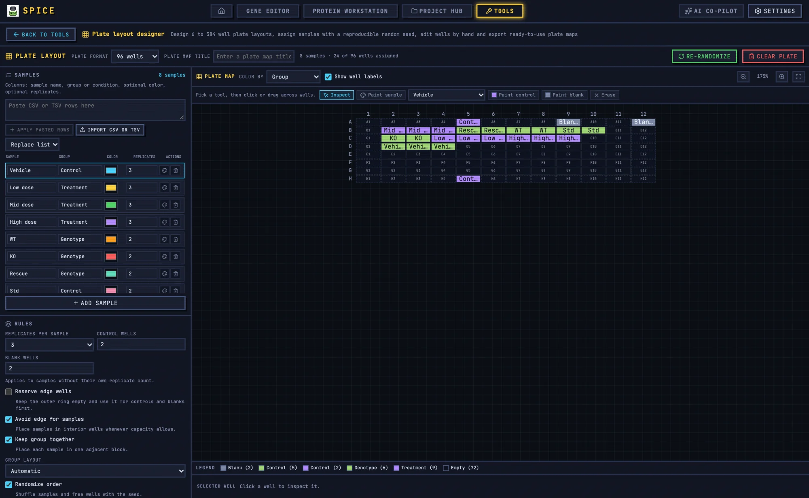

# Plate Layout Designer

The Plate layout designer creates reproducible 6- to 384-well plate maps with samples, controls, blanks, edge protection, grouping, and seeded randomisation.



## 1. When to use it

Use it when you need to decide where each sample and control goes before pipetting: qPCR plates, ELISA plates, cell-culture plates, or a dilution series. The output is a plate map for the bench and for downstream analysis.

## 2. Choose a format

Select the plate format from the format control. The tool supports 6- to 384-well plates. The format determines the well grid, the available rows and columns, and the maximum sample count.

Changing the format after generating a layout can invalidate placements. Regenerate and rerun the rule checks.

## 3. Import samples

Open the **Samples** panel and paste or import a sample sheet. The shared sample format supports sample name, group, type, and replicate count.

A practical sheet looks like:

```csv
sample,group,type,replicates
Control_1,Control,sample,3
Control_2,Control,sample,3
Treated_1,Treated,sample,3
Treated_2,Treated,sample,3
```

The plate map exchange format is `well,sample,group,type,replicate`. This is also the format qPCR analysis can consume.

## 4. Set the rules

Open the **Rules** panel. The defaults are:

| Rule | Default |
|---|---|
| Replicates per sample | 3 |
| Controls per plate | 2 |
| Blanks per plate | 2 |
| Avoid edge | true |
| Keep replicates together | true |
| Group layout | auto |
| Randomize | true |
| Seed | 20261102 |

**Avoid edge** reserves edge wells for controls and blanks rather than samples. This is common for cell-culture plates where edge evaporation is a concern. If every well is needed for samples, turn it off and accept the edge effect.

**Keep replicates together** places replicate wells adjacent. For qPCR, adjacent replicates are convenient but can share pipetting errors. Some labs prefer randomised positions; choose your standard and record it.

**Group layout** controls whether groups are arranged by row, column, or block.

## 5. Generate the layout

1. Review the sample list and rules.
2. Keep or change the seed. The seed makes the randomisation reproducible.
3. Click **Generate**.
4. Open **Rule checks**.
5. Resolve every issue: insufficient wells, unplaced replicates, missing controls or blanks, edge violations, or conflicts.
6. Correct individual wells with the paint bar if needed.
7. Rerun **Rule checks** after manual edits.

The selected-well bar shows the current well contents. The legend shows group colours and the control/blank categories.

## 6. Manual editing

The paint bar lets you assign a sample, control, blank, or empty state to a well. Manual edits can break the rules; rerunning the rule checks is not optional.

If you are designing a qPCR plate, keep the target gene assignment separate from the plate layout. The plate layout stores sample, group, type, and replicate; the qPCR tool adds target and Ct.

## 7. Worked example: 96-well qPCR plate

Task: eight samples, three replicates each, two controls, two blanks, edge wells reserved.

1. Open **Tools → Plate layout designer**.
2. Choose the 96-well format.
3. Paste the eight samples with three replicates each.
4. Set controls 2, blanks 2, avoid edge on, keep together on, group layout auto.
5. Keep the seed and write it in your notebook.
6. Generate.
7. Check the rule report. If there are not enough wells, reduce replicates or use a larger plate.
8. Inspect the plate: controls and blanks should be at the edge, samples inside.
9. Export the plate map CSV.
10. Import it into qPCR analysis or hand it to the person pipetting.
11. Save the plate document and export a repro bundle.

## 8. Exports

- **CSV/TSV plate map** with `well,sample,group,type,replicate`.
- **SVG** plate figure.
- **PNG** at the chosen DPI.
- **Clipboard image**.
- **Project JSON**.
- **Repro bundle**.

## 9. Plate-to-qPCR handoff

The plate map is the bridge between design and analysis. qPCR analysis can read the map and convert it to:

`well sample target ct group replicate`

This preserves well, sample, group, and replicate metadata and avoids retyping. Add the target and Ct values from the instrument export.

## 10. Caveats

- Reproducibility depends on keeping the seed.
- Avoid-edge placement requires enough non-edge wells for the samples.
- Manual paint edits are not guaranteed to satisfy every rule; rerun the checks.
- Changing the plate format can invalidate the layout.
- The tool does not know your pipetting scheme or reagent dead volumes; review the map before running the assay.

For shared tool concepts, see [Bench tools](README.md). For the downstream analysis, see [qPCR analysis](qpcr.md).
