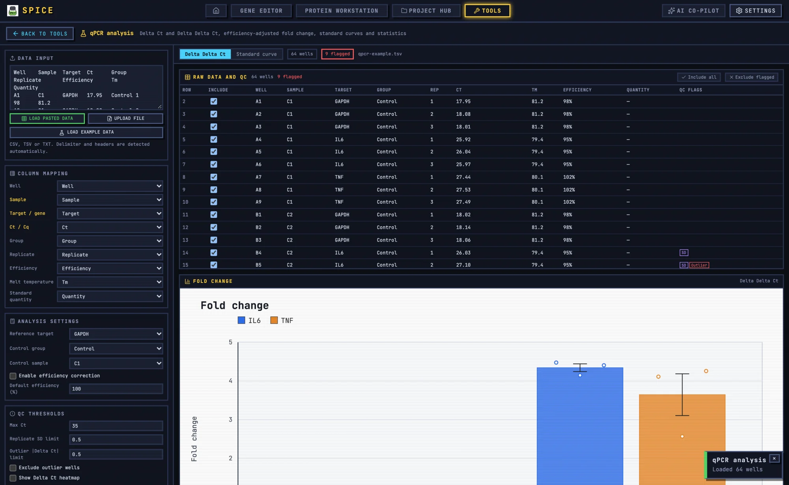

# qPCR Analysis

The qPCR tool reads plate-reader exports, maps columns, runs ΔΔCt or standard-curve analysis, flags QC problems, and exports a results table and chart.

## 1. When to use it

Use this tool for relative expression (ΔΔCt), standard-curve quantification, or a quick review of a plate before moving data into a statistics package. It is not a replacement for the instrument software's amplification curves; it works from Ct values.

## 2. Input formats

The **Data input** panel accepts pasted text or a file. Supported delimiters are tab, comma, and semicolon. Quoted fields are handled.

Canonical columns are:

`well`, `sample`, `target`, `ct`, `group`, `replicate`

Optional columns include quantity and standard-curve fields.

The tool auto-maps common header names. If a column is misassigned, use **Column mapping** to select the correct source column for each field.

A plate layout exported from the [Plate layout designer](plate.md) can be imported as a plate map. Its header is `well,sample,group,type,replicate`; qPCR conversion adds the target and Ct fields as `well sample target ct group replicate`.

## 3. Load the example

Click **Load example** to insert a deterministic dataset containing:

- Targets GAPDH, IL6, and TNF.
- Standard-curve samples.
- One “Undetermined” well.
- One high-Ct well.
- One duplicate well.

Use it to see how QC flags and the result tabs behave before loading real data.

## 4. Analysis settings

### 4.1 Reference target

Set one or more reference targets. GAPDH is the common choice for a single reference. When multiple references are selected, the tool uses the geometric mean of their Ct values. All references must be present and usable in a sample; a missing reference invalidates that sample's ΔCt.

### 4.2 Control group

Set the control group. ΔΔCt is calculated relative to the mean ΔCt of the control group. Without a control group, ΔΔCt is not meaningful.

### 4.3 Efficiency correction

Enable efficiency correction only when you have valid standard curves. Enter the per-target efficiency or accept the default 100%. The tool then uses the target and reference efficiencies rather than a flat 2 in the fold-change calculation.

If you have no standard curves, leave efficiency correction off and state the 2^−ΔΔCt assumption in your methods.

### 4.4 QC thresholds

Defaults are:

| Setting | Default |
|---|---|
| High Ct threshold | 35 |
| Replicate SD limit | 0.5 |
| Outlier limit | 0.5 |
| Exclude outliers | false |
| Efficiency correction | false |
| Default efficiency | 100% |
| Quantity is log10 | false |
| Show heatmap | false |

Raise or lower these to match your assay and instrument. Record any non-default thresholds.

## 5. QC flags

The tool flags:

- Undetermined wells.
- High Ct.
- Replicate SD above the limit.
- Outliers.
- Duplicate wells.

An undetermined well should normally be excluded, not treated as a high Ct. A high Ct near the threshold is a sensitivity issue; state the threshold. A replicate SD flag means technical variation; inspect the replicates before excluding. A duplicate well can double-count a replicate.

Outliers are retained by default. If you enable exclusion, the exported CSV should still retain the flag, and the methods should state the rule.

## 6. Results

The results view reports:

- Per-well Ct and QC state.
- ΔCt and ΔΔCt.
- Fold change.
- Per-replicate fold values.
- Group mean, SD, SEM, confidence interval, and Welch p value.
- Standard-curve slope, intercept, R², and efficiency when a curve is present.

The heatmap view shows the plate layout coloured by Ct or result. Use it to spot edge effects, failed wells, and spatial patterns.

## 7. Worked example: IL6 and TNF induction

Task: compare untreated and treated samples with GAPDH as the reference and three biological replicates.

1. Open **Tools → qPCR analysis**.
2. Click **Load example** to see the expected format, or paste the instrument export.
3. Confirm the delimiter and column mapping.
4. Set GAPDH as the reference target.
5. Set the control group to the untreated samples.
6. Set high Ct to 35, replicate SD to 0.5, and outlier limit to 0.5.
7. Leave outlier exclusion off for the first pass.
8. If standard curves are present, check the fit and decide whether to enable efficiency correction.
9. Run the analysis.
10. Inspect QC flags. Fix mapping errors before excluding wells.
11. Review ΔCt, ΔΔCt, fold change, group summaries, and p values.
12. Open the chart view, show individual points if possible, and label the error bars.
13. Export the results CSV and chart SVG/PNG.
14. Save the qPCR document to the project and export a repro bundle.

## 8. Chart and Figure Studio

The chart view plots fold change by target and group. **Send to Figure Studio** sends the chart image to [Figure Studio](figure.md) for a multi-panel figure.

The chart is an image handoff, not a live link. If the analysis changes, resend the chart.

## 9. Exports

- **Results CSV** with well-level results, group summaries, QC flags, and standard-curve output.
- **Chart SVG** and **PNG**.
- **Project JSON** (`SPICE_QPCR` v1).
- **Repro bundle** with the chart, CSV, project, parameters, methods, and manifest.

## 10. Caveats

- The tool assumes a defined control group.
- Multiple reference genes use a geometric mean; missing references invalidate a sample.
- The example intentionally includes QC failures.
- There is no image batch mode; the practical limit is the pasted/file input size.
- The tool analyses Ct values, not amplification curves. Check the instrument software for curve quality, baseline, and threshold settings.
- Statistical tests are descriptive; they do not account for nested plate or batch effects. Use a mixed model or your lab's standard pipeline for complex designs.

For shared tool concepts, see [Bench tools](README.md). For plate design, see [Plate layout designer](plate.md).
