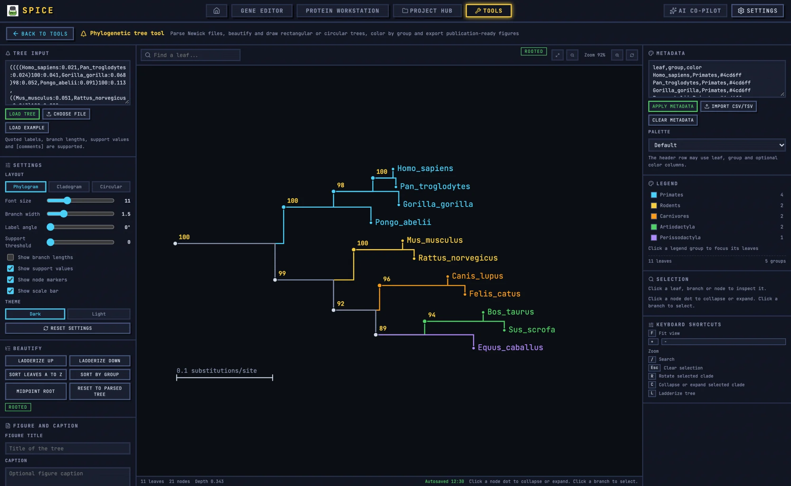

# Phylogenetic Tree Tool

The Phylogenetic tree tool parses Newick trees, redraws them as phylograms, cladograms, or circular trees, colours leaves by group, and exports publication-ready SVG or PNG.



## 1. When to use it

Use it to display a tree produced elsewhere: a maximum-likelihood or Bayesian phylogeny, a clustering dendrogram, or a similarity tree. The tool draws and annotates trees; it does not infer them from sequences. For sequence alignment, use the Gene Editor's alignment panel; for distance-based exploration, use the Gene Editor's BLAST and evolution panel.

## 2. Load a tree

Paste Newick text into `Tree input`, drop a `.nwk` file, or click `Choose file`. `Load example` gives a working tree. Files are limited to 20 MB.

The parser supports quoted labels, branch lengths, support values, and `[comments]`. Errors are specific: empty input, unexpected character, missing closing parenthesis, invalid branch length, comma in an invalid position, unexpected end, unterminated quoted label or comment, and no root. The error includes the character position.

After loading, the status bar reports leaves, nodes, depth, and collapsed count.

## 3. Layout

The `Settings` panel controls:

- `Layout`: `Phylogram`, `Cladogram`, `Circular`.
- `Font size`, `Branch width`.
- `Label angle` for rectangular layouts.
- `Support threshold`: hides support labels below the value.
- `Show branch lengths`, `Show support values`, `Show node markers`, `Show scale bar`.
- `Theme`: `Dark` or `Light`.
- Scale bar units default to `substitutions/site`.

If the tree has no usable branch lengths, the tool reports `No usable branch lengths. Drawing an equal-branch cladogram.` A cladogram shows topology only; do not read branch length as distance.

`Reset settings` restores defaults without changing the tree.

## 4. Beautify the tree

The `Beautify` panel provides `Ladderize up`, `Ladderize down`, `Sort leaves A to Z`, `Sort by group`, `Midpoint root`, `Rooted`/`Unrooted`, and `Reset to parsed tree`.

- Ladderizing reorders children by subtree size; it changes the drawing, not the topology.
- Midpoint rooting requires at least one positive branch length.
- `Reset to parsed tree` discards all beautify operations.

For a publication figure, state whether the tree was midpoint-rooted and whether leaves were sorted. These choices affect the visual impression but not the underlying splits.

## 5. Metadata and colour

Paste a table into `Metadata`:

```csv
leaf,group,color
Homo_sapiens,Primates,#4cd6ff
Mus_musculus,Rodentia,#ffb45c
```

The header row may use `leaf`, `group`, and an optional `color` column. `Import CSV/TSV` loads a file; `Clear metadata` removes it; `Apply metadata` matches leaf names. The tool reports the number of leaves matched and warns when no leaves match.

`Palette` choices: `Default`, `Warm`, `Cool`, `Colorblind safe`. The `Legend` shows groups and counts; click a group to focus its leaves, and `Show all groups` clears the focus. Unmatched leaves are `Ungrouped`.

Leaf names must match exactly, including case and spaces. Quoted Newick labels may contain spaces; use the same string in the metadata table.

## 6. Inspect and edit

Click a leaf, branch, or node to inspect it. The `Selection` panel reports `Leaf` or `Clade`, name, branch length (`Missing` if absent), support (`None` if absent), children, descendant leaf count, and comments.

Actions: `Collapse clade`, `Expand clade`, `Rotate children`, `Clear selection`. Collapsed clades show a badge with the leaf count. The path to the root is highlighted.

`Find a leaf...` searches with `Next match` / `Previous match` and reports `i of n` or `No match`.

Keyboard: `F` or `0` fits the view, `+`/`-` zooms, `R` rotates the selected clade, `C` collapses or expands it, `L` ladderizes, `/` focuses search, `Escape` clears the selection.

## 7. Support values and comparison

`Support distribution` bins internal-node support in 0–100 and reports min/max/mean, with shown and filtered nodes distinguished by the current threshold.

`Tree comparison` loads a second Newick tree and compares splits on the shared leaf set:

- Robinson–Foulds distance and normalised RF.
- Shared splits and unique splits.
- Shared leaves and leaves only in one tree.
- A statement when the trees are identical on the shared leaf set.

RF comparison needs the same leaf set; missing leaves are reported separately rather than silently ignored.

## 8. Export

- **SVG** with real text objects.
- **PNG** at 300 or 600 dpi. If the figure is too large at the requested dpi, it is exported at a reduced scale and the tool says so.
- **Newick (edited)** including collapse, rotation, and rooting changes.
- **Newick (original)** as parsed.
- **Project JSON**.
- **Repro bundle**.

`Send to Figure Studio` places the tree into a multi-panel figure. The handoff is an image, not a live link; resend after edits.

## 9. Worked example: primate phylogeny figure

1. Paste the Newick string from your tree inference tool.
2. Check the parse; fix any branch-length error at the reported position.
3. Choose `Phylogram` and enable `Show support values` and `Show scale bar`.
4. Set `Support threshold` to 70 so weak support is not labelled.
5. Paste a `leaf,group,color` metadata table and apply it.
6. Choose the `Colorblind safe` palette.
7. Ladderize and sort by group for a readable order.
8. Collapse a large outgroup clade to save space.
9. Add a title and caption.
10. Export SVG and PNG 600 dpi; export the edited Newick alongside the figure.
11. Save the project JSON and repro bundle.

## 10. Caveats

- The tool draws trees; it does not infer them.
- A cladogram carries topology only, not distance.
- Support thresholds hide labels, not branches; a low-support branch still appears.
- Metadata matching is exact and case-sensitive.
- Collapsing and rotating change the drawing; the edited Newick records those changes.
- RF comparison requires comparable leaf sets.
- PNG export may reduce scale for very large figures; use SVG for large trees.

For shared tool concepts, see [Bench tools](README.md). For figure assembly, see [Figure Studio](figure.md).
